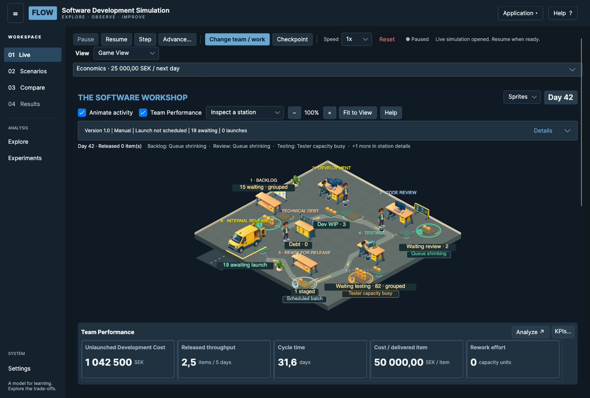

# Getting Started {#getting-started}

FLOW is a learning tool for exploring how software work moves through a team. It makes queues, shared capacity, release delays and staffing costs visible. It supports asking *what might happen under these assumptions?* It is not a forecast of a particular company or an employee-performance measurement system.

Start with one baseline, observe several simulated days, and change one assumption at a time. Read a result alongside its measurement period and the work that remains unfinished.

## Your first simulation {#getting-started.first-simulation}

1. Open **Live** in the left navigation. Review the setup assumptions and use **Start**.
2. Use **Pause** to stop at a completed simulated-day boundary. Choose **Game View** in the **View** selector.
3. Use **Step** to advance one simulated day. **Resume** continues playback; **Advance…** exposes **Run to Day** for a target day.
4. Watch both waiting work and completed releases. A busy station does not necessarily increase delivery.
5. Select a station or waiting queue. Inspect the item list and the evidence behind its condition.
6. Click a Team Performance card to open its detailed KPI Explorer. A key performance indicator (KPI) is a measurement, not a judgement.
7. Create a **Checkpoint** before an intervention so you can return to the same model state.

A simulated day is an abstract working period. Playback speed changes how fast days are shown, not the capacity or formulas applied on each day.

[Understand the controls](#live-game-view.navigation) before running a long experiment.

## Read the LIVE workspace {#getting-started.workspace}

*Historical B6.5.2 layout illustration, Day 42; values are an example, not defaults. Numbered markers are a separate, scalable overlay. For the current Save/Open controls, see [Controls and navigation](#live-game-view.navigation).*

1. **Simulation controls** advance or pause time and expose changes and checkpoints.
2. **Product version** summarizes the active version, launch strategy and awaiting items.
3. **Workshop** shows the flow of work. Sprites are bounded representations of aggregate observations.
4. **Stations and queues** are interactive. Count labels remain exact even when packages are grouped.
5. **Team Performance** shows name, value and unit. Click a card for definition, period, comparisons and history.

The dark surfaces group information. Blue highlights primary controls; queue colors distinguish observations, not employee performance. Consult text and counts rather than color alone.

## A first experiment {#getting-started.first-experiment}

Choose a question such as “Will one additional tester reduce the waiting-for-testing queue?” Record the baseline queue, cycle time, released throughput and team cost. Pause, create a checkpoint, select **Change team / work**, change one setting, add an optional label and apply.

A configuration change recorded on Day N affects Day N+1. Allow enough subsequent days for existing work to progress. Compare equivalent observed periods and check for another queue growing upstream or downstream. More staffing can increase cost even if releases do not increase.

Use the guided comparison when its supported staffing experiment matches your question. Broader scenario exploration is available through Scenarios, Compare and Explore. These are separate analyses; opening another workspace can pause LIVE. Opening this guide does not pause LIVE.

## Know what the model leaves out {#getting-started.limitations}

FLOW represents shared capacity, not individually scheduled employees. It does not measure business value, revenue, profit, customer adoption, real salaries or actual calendar dates. A release animation is not a real deployment. Work items differ in size, so item counts alone can mislead.

Results depend on arrival assumptions, effort distributions, seed, settings and intervention history. Inspect several seeds for broader claims. A single favorable run does not establish a causal truth about a real organization.
