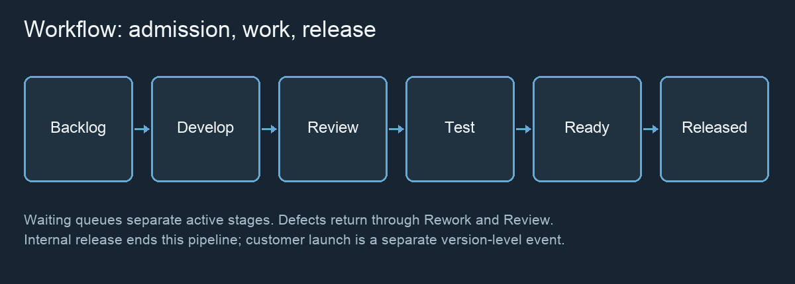

# How FLOW Works {#how-flow-works}

Work progresses through active stages and explicit waiting states. At the start of a simulated day, eligible work is admitted according to active-stage limits. Capacity is then applied. A stage completion normally waits for the next day’s admission to the following active stage. Internal release is a deliberate exception: successful testing can become eligible at that same end-of-day boundary.

The usual path is:

`Backlog → Development → Waiting for Code Review → Code Review → Waiting for Testing → Testing → Ready for Release → Internally Released → Customer Launch`

Defects can send review or testing work to Waiting for Rework, then Rework, then back through Code Review.

*Explanatory diagram, not a screenshot. Review and Testing defects return through Rework.*

## Backlog and arrivals {#workflow.backlog}

Backlog is work that has not started Development. It includes eligible work and dependency-blocked work. It is not active Development WIP.

- **Fixed backlog** uses the supplied work population.
- **Continuous arrival** adds work using the configured daily rate and accumulated fractional arrivals. A fractional rate does not mean a fraction of an item is processed as a new item.
- **Always available** supplies enough new work to fill available Development slots after accounting for existing eligible backlog.

A low backlog may indicate insufficient arrivals rather than efficient delivery. Dependencies can prevent admission despite spare capacity.

## Development and shared capacity {#workflow.development}

Development implements work. Developers also serve Code Review, Rework and technical-debt repayment. Their daily pool is shared; it is not independently available in full to every station.

The priority is **Code Review → Rework → debt repayment → Development**. Available developer capacity is developer count × nominal capacity per developer × availability. Increasing nominal capacity does not bypass the per-item contribution limit.

Review, Rework and Testing each allow at most one nominal contribution per item per day, capped at the smaller of one capacity unit and the role’s nominal per-person capacity. Fractional remaining work consumes only the capacity needed. Stage productivity converts consumed capacity into effective work.

Development first covers admitted items in queue order, then considers collaboration using remaining eligible capacity. Work can be admitted yet receive no capacity that day.

## Code Review {#workflow.code-review}

Code Review uses the shared developer pool before Rework and new Development. Waiting for Code Review is a separate queue. An item in this queue is not counted against the active Code Review limit.

Successful review sends work to Waiting for Testing. If configured quality checks find a defect, work waits for Rework instead. An additional developer can help review, but also increase the supply of new development; look at the full flow before concluding where the constraint lies.

## Testing and tester capacity {#workflow.testing}

Testing uses its own tester capacity pool: tester count × nominal tester capacity × tester availability. Developers do not automatically substitute for testers. Successful testing moves work to Ready for Release. A discovered defect returns it through Rework and Code Review.

A testing queue can grow when incoming work exceeds what testing finishes. High tester utilization supports a capacity-pressure observation, but it does not prove the unique cause. Changing productivity, effort mix, WIP or upstream supply can change the queue too.

Inspect the queue’s exact count, trend and observation period. Increasing the active testing limit only admits more work; it does not add tester capacity.

## Waiting queues and pressure {#workflow.queues}

Waiting states separate readiness from active work. Queue counts are exact; visible package stacks are bounded and may group many items. Station inspection gives active work, waiting work, capacity observations and the recent evidence window.

The workshop uses up to four recent daily snapshots after the latest intervention. Sustained pressure requires four nondecreasing queue counts with overall growth and full relevant capacity use on each of the last three days. Otherwise recent growth is labelled **Queue growing**, not a proven bottleneck. Zero configured capacity and scheduled release accumulation have separate explanations. A shrinking queue is distinct from a stable one.

The workshop’s short evidence window is different from the KPI rolling window and from the review-queue regression slope. Do not compare these as though they were the same metric.

## Work in progress and limits {#workflow.wip}

Work in progress (**WIP**) means started but not internally released work when used as the Total WIP KPI. It includes active work, intermediate queues and Ready for Release, but excludes Backlog.

Stage WIP limits have a narrower meaning: they count only items in that active state. Development, Code Review, Testing and Rework have their own admission limits. Reducing a limit does not discard already admitted work; admissions wait until there is room.

A higher WIP limit does not increase capacity. It may allow more simultaneous work and larger downstream queues. A very low limit may leave capacity unused. Test the trade-off with cycle time, age of WIP and throughput.

## Productivity versus capacity {#workflow.productivity}

Stage productivity is effective effort completed per raw capacity unit consumed. The Development, Code Review and Testing defaults are each **1.0**. For example, 0.5 raw capacity at productivity 2.0 completes 1 effort unit, if that much effort remains.

Productivity does not add people, change available raw capacity or directly reduce daily staffing cost. Utilization uses consumed raw capacity, not effective effort. Rework retains its own raw-work behavior rather than inheriting a stage-productivity multiplier. Debt repayment uses Development productivity.

## Skills and specialists {#workflow.skills}

Specialists are a subset of the configured developer count, not additional staff. A configured fraction of arriving work can require specialist Development. That requirement is attached to the item. With no eligible specialist capacity, such work can occupy Development WIP without progressing.

After higher-priority shared work, remaining Development capacity is split proportionally between specialist and general capacity. Specialist work uses the specialist portion. Remaining specialist capacity can help general work. Specialist collaboration requires at least two specialists; general collaboration requires at least two developers. The model does not schedule named individuals or track training.

## Collaboration {#workflow.collaboration}

Development may use a second contribution after primary coverage, prioritizing items with the smallest remaining effort. The second contribution consumes raw capacity but works at **50% of Development productivity**. Each item receives at most a primary and a second contribution in a day, subject to eligible capacity.

This models a limited collaboration benefit, not unrestricted parallel processing. It does not apply to Code Review or Testing. Two nearby animated workers illustrate aggregate activity; they are not authoritative individual assignments.

## Defects and Rework {#workflow.rework}

When quality behavior is enabled, completed Code Review and Testing attempts can discover defects according to their configured probabilities. Rework effort is sampled from the relevant configured distribution. Work joins Waiting for Rework, is admitted under its own active limit, consumes shared developer capacity, and returns to Waiting for Code Review.

Rework can happen more than once. It competes with new Development and affects delivery time and allocated cost. Rework effort is capacity consumed, not a defect percentage. Rework monetary cost is an allocation within staffing cost, not an extra charge.

## Technical debt {#workflow.technical-debt}

Technical debt is an effort-based system state. Its ratio is outstanding debt divided by cumulative original Development scope (zero before any scope). Overhead is `max(0, ratio − tolerance) × impact factor`.

At Development admission, the model fixes a plan based on the current debt state. Normal planned effort is base effort × (1 + overhead). A selected shortcut reduces that effort; saved effort × creation factor becomes debt when Development completes. Later changes do not retroactively rewrite that item’s start-time plan.

After review and Rework, configured repayment uses a fraction of remaining developer capacity, limited by debt left to repay. Development productivity converts repayment capacity to debt removed. Defaults include shortcut rate 0%, effort reduction 30%, tolerance 10%, repayment 0%, creation factor 1 and impact factor 1. Debt is not a monetary liability.

## Dependencies {#workflow.dependencies}

An unresolved dependency blocks admission from Backlog, not an already active worker. Explicit item dependencies are satisfied when the required item is work-complete (Ready for Release or internally released); they do not wait for customer launch.

Residual dependencies model an external delay assigned on arrival using a separate random stream. The waiting time is a geometric whole-day sample with the configured mean. Defaults are a 0% rate and zero mean waiting days. Already assigned delays are not redrawn after an intervention. Dependency waiting is included in Backlog and uses no developer or tester processing capacity.

## Seeds and replay {#workflow.determinism}

The model uses seeded random streams and stores their state in checkpoints and saved LIVE sessions. The same starting state, settings and sequence of decisions reproduce the same model execution. UI animations and opening documentation do not consume model randomness.

The default request seed is 12345. A seed is not a guarantee that two different policies encounter identical later events: interventions can change which events occur and when streams are consumed. Keep the same checkpoint for a controlled comparison, record the intervention history, and use multiple seeds before generalizing.
