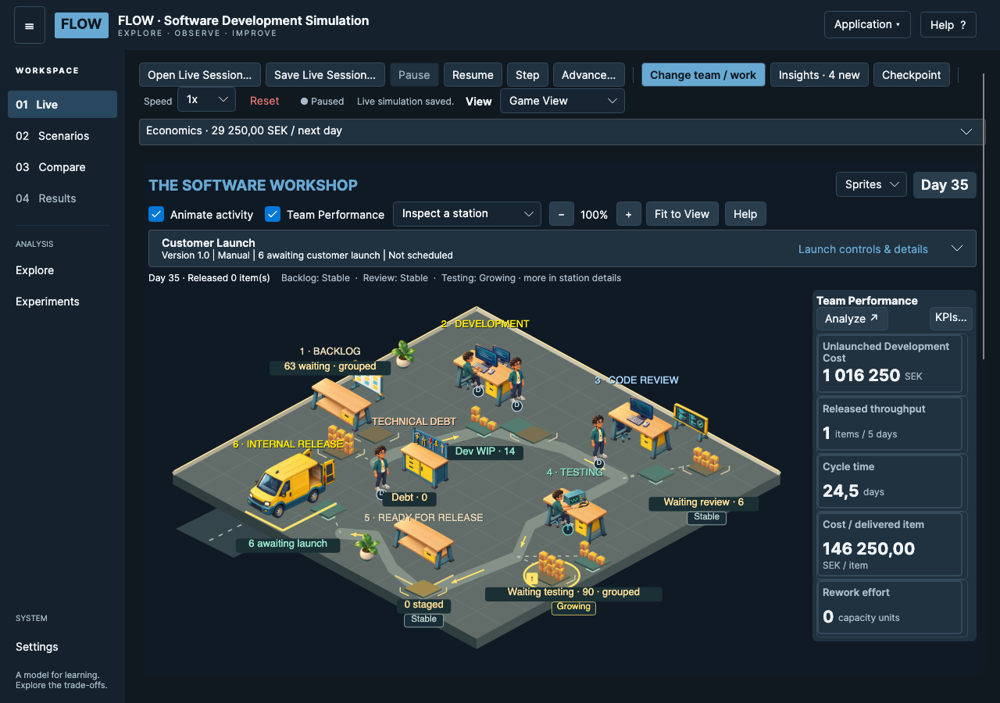
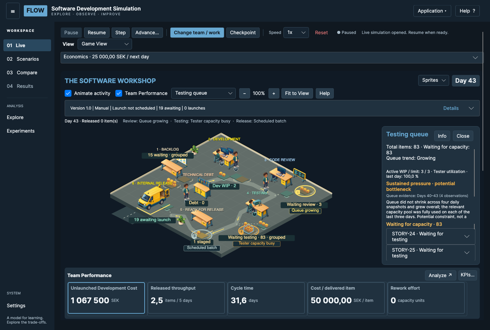

# LIVE & Game View {#live-game-view}

LIVE is the interactive timeline. Game View and Flow Board present the same session. Changing the visualization does not create a second simulation. The workshop is a way to inspect state, not an independent game engine.

## Controls and navigation {#live-game-view.navigation}

| Control | What it does |
| --- | --- |
| Pause / Resume | Stop or continue simulated-day playback. |
| Step | Advance one complete simulated day. |
| Advance… / Run to Day | Advance toward a target; a pending customer-launch decision can stop it. |
| Change team / work | Pause and edit supported assumptions; Apply Changes records an intervention. |
| Checkpoint | Capture a state for later restoration or comparison. |
| Speed | Change playback speed, not simulation capacity or formulas. |
| View | Choose Game View or Flow Board for the same session. |
| Open Live Session… | Open a saved timeline, even before starting a session. Cancel or a load error keeps the current session; file operations pause LIVE. |
| Save Live Session… | Pause and explicitly save the current timeline and checkpoints. Available after Start. |
| Reset | Ask before discarding the current timeline and checkpoints. Cancel keeps the session and its playback state unchanged. Saved files are not deleted. |

**Open Live Session…** and **Save Live Session…** are in the LIVE toolbar. They are also available under **Checkpoints and files**, alongside **Restore** and **Delete**. Restore returns to captured model state; do not confuse it with undoing a visual zoom.

Scenarios performs a separate run. Compare and Explore investigate alternatives. Leaving LIVE pauses the session; opening the non-modal user guide does not. Use **Application → Exit Application** to close gracefully (Cmd+Q on macOS; standard Windows exit behavior). There is no automatic simulation save on exit. **Application → About FLOW** shows the public application version and the commit/source status embedded in this build. These are separate from simulation model and saved-data format versions.

*Current FLOW UI, Day 35 example. Actual Avalonia/Skia control rendering; not a native macOS capture. Open is also available before Start; Save is disabled until a session exists.*

## Zoom, pan and Fit to View {#live-game-view.camera}

Use **+**, **−** and **Fit to View**. Fit centers the complete scene in the actual available workshop viewport. Manual zoom and pan survive ordinary LIVE updates.

Ordinary mouse-wheel or two-finger scrolling scrolls the page. Hold **Cmd** on macOS, or **Ctrl** on Windows/Linux, while scrolling to zoom around the pointer. Drag empty scene space to pan, or use a middle-button drag anywhere. Zoom is bounded to 75–250% of the fitted scale.

On a small window, cards or below-workshop inspection may require scrolling. Resize or select Fit to View if you lose your bearings. A pan or scroll gesture should not select a station accidentally.

## Inspect stations, queues and items {#live-game-view.station-inspection}

Click a station, a waiting queue or the release vehicle; alternatively use **Inspect a station**. The selected area is highlighted. The panel contains exact work counts, relevant capacity and utilization, recent queue evidence and an expandable item list. **Info** retains the concise analytical explanation; **Learn more** opens this guide.

With the workshop focused, arrow keys select stations, Enter or Space opens inspection, and Escape clears it. **Close** closes the panel. Expanding a work item reveals its observed state and history; the UI preserves selection and expansion across ordinary updates.

The release vehicle opens internal-release context: items awaiting customer launch and their estimated allocated cost, excluding WIP and overhead. The cumulative internally released count elsewhere is not necessarily the awaiting count.

*Numbered overlay: 1 Development; 2 Code Review; 3 Testing; 4 testing queue; 5 internal release vehicle. Exact values belong to the captured example.*

## Read animations cautiously {#live-game-view.animation}

**Animate activity** can be turned off to reduce motion. Workers, furniture and package stacks remain bounded representations. D indicates developer, T tester and S specialist. The model does not assign each sprite to a real worker.

Package movement and release trips illustrate already observed events. At high speeds events can be grouped and unnecessary movement reduced. Pausing LIVE freezes activity. A customer-launch celebration follows an authoritative launch event; an internal release vehicle trip alone does not prove customer delivery.

## Team Performance and analysis {#live-game-view.performance}

Compact cards intentionally show only name, current value and unit. **KPIs…** chooses up to four metrics in addition to the pinned Unlaunched Development Cost balance. **Analyze ↗** or clicking a card opens the existing non-modal KPI Explorer.

In Explorer choose **Rolling evaluation · days** (10, 20 or 40), the primary KPI and optionally another KPI. **Compare KPIs** preserves each metric’s units and scales; **Compare Scenarios** exposes the existing experiment comparison. **Return to compact view** closes the detail window without discarding the selected period.

The rolling evaluation window differs from the historical range on the horizontal axis. A balance metric is not a rolling cost. Hover the chart for observed values; missing observations are not zero. Product Version **Details** provides Customer delivery, Launch Economics and Launch history.
