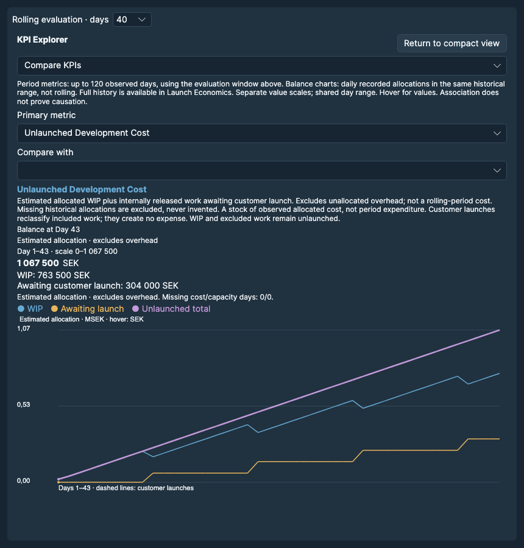

# KPIs & Performance {#kpis-performance}

A KPI is a key performance indicator. Read its **unit**, **calculation basis** and **measurement period** before comparing values. Higher is not always better. The compact dashboard and Explorer use the same authoritative observations.

Rolling evaluation windows are 10, 20 or 40 days. At Day D, a window W includes max(1, D−W+1) through D. Early periods use available observations. The previous-period comparison is unavailable until two complete windows exist. Explorer displays up to 120 historical days; each rolling point uses its own trailing evaluation window. The unlaunched-cost balance instead shows accumulated allocation at each day.

*The horizontal axis is observed simulation days. The cost chart distinguishes WIP, awaiting launch and their total; the display can label large amounts in MSEK (millions of Swedish kronor). The balance is not a sum over the rolling evaluation window.*

## Released throughput {#kpi.released-throughput}

**Definition and calculation basis:** Internally released items / observed days × 5. Partial history uses observed days only.

**Unit:** items / 5 days. **Basis:** Period rate.

**Measurement period:** Selected inclusive rolling evaluation period; use available observed days for partial history.

**Interpretation and common misunderstanding:** Ten releases across 20 observed days give 2.5 items / 5 days. Counts do not measure work size or customer value.

Read this indicator alongside the workload and relevant queues. N/A means the required cohort, denominator or complete observation is unavailable; it is not a zero result.

## Cycle time {#kpi.cycle-time}

**Definition and calculation basis:** Development start to release, averaged over items released in the window. N/A without releases.

**Unit:** days. **Basis:** Released cohort average.

**Measurement period:** Selected inclusive rolling evaluation period; use available observed days for partial history.

**Interpretation and common misunderstanding:** A mean excludes unfinished work. It includes waiting and internal-release delay after Development starts, but excludes Backlog time and time after internal release.

Read this indicator alongside the workload and relevant queues. N/A means the required cohort, denominator or complete observation is unavailable; it is not a zero result.

## Cost / delivered item {#kpi.cost-per-item}

**Definition and calculation basis:** Recorded team cost / internally released items. N/A without releases or complete monetary observations.

**Unit:** SEK / item. **Basis:** Period ratio.

**Measurement period:** Selected inclusive rolling evaluation period; use available observed days for partial history.

**Interpretation and common misunderstanding:** A batch crossing the window boundary can change this ratio sharply. It is not the item-by-item allocated cost of the released cohort.

Read this indicator alongside the workload and relevant queues. N/A means the required cohort, denominator or complete observation is unavailable; it is not a zero result.

## Rework effort {#kpi.rework-effort}

**Definition and calculation basis:** Actual raw developer capacity consumed by Rework. Not a percentage or inferred defect effort.

**Unit:** capacity units. **Basis:** Period total.

**Measurement period:** Selected inclusive rolling evaluation period; use available observed days for partial history.

**Interpretation and common misunderstanding:** One capacity unit is an abstract resource amount, not one hour or one defect.

Read this indicator alongside the workload and relevant queues. N/A means the required cohort, denominator or complete observation is unavailable; it is not a zero result.

## Total team cost {#kpi.total-team-cost}

**Definition and calculation basis:** Sum of recorded daily staffing cost, including idle available staff. N/A if any monetary observation is missing.

**Unit:** SEK. **Basis:** Period total.

**Measurement period:** Selected inclusive rolling evaluation period; use available observed days for partial history.

**Interpretation and common misunderstanding:** This period total includes idle available staff. It is not the accumulated Unlaunched Development Cost balance.

Read this indicator alongside the workload and relevant queues. N/A means the required cohort, denominator or complete observation is unavailable; it is not a zero result.

## Developer utilization {#kpi.developer-utilization}

**Definition and calculation basis:** Total used / total available developer capacity. N/A when available capacity is zero.

**Unit:** %. **Basis:** Period ratio.

**Measurement period:** Selected inclusive rolling evaluation period; use available observed days for partial history.

**Interpretation and common misunderstanding:** Use the ratio of summed capacity, not the average of daily percentages. High utilization can coincide with long queues.

Read this indicator alongside the workload and relevant queues. N/A means the required cohort, denominator or complete observation is unavailable; it is not a zero result.

## Tester utilization {#kpi.tester-utilization}

**Definition and calculation basis:** Total used / total available tester capacity. N/A when available capacity is zero.

**Unit:** %. **Basis:** Period ratio.

**Measurement period:** Selected inclusive rolling evaluation period; use available observed days for partial history.

**Interpretation and common misunderstanding:** Zero available tester capacity produces N/A, not 0% or 100%. A busy testing pool does not identify the only root cause.

Read this indicator alongside the workload and relevant queues. N/A means the required cohort, denominator or complete observation is unavailable; it is not a zero result.

## Total WIP {#kpi.total-wip}

**Definition and calculation basis:** Started but unreleased work at the final observed day, including queues and Ready for Release.

**Unit:** items. **Basis:** End-of-period snapshot.

**Measurement period:** Final observed day of the selected window.

**Interpretation and common misunderstanding:** Stage WIP limits count active states only; this KPI includes started waiting work and Ready for Release.

Read this indicator alongside the workload and relevant queues. N/A means the required cohort, denominator or complete observation is unavailable; it is not a zero result.

## Development queue {#kpi.development-queue}

**Definition and calculation basis:** Existing Backlog count, including dependency waiting; not active Development.

**Unit:** items. **Basis:** End-of-period snapshot.

**Measurement period:** Final observed day of the selected window.

**Interpretation and common misunderstanding:** The label means Backlog, including dependency waiting. It is not active Development.

Read this indicator alongside the workload and relevant queues. N/A means the required cohort, denominator or complete observation is unavailable; it is not a zero result.

## Code Review queue {#kpi.review-queue}

**Definition and calculation basis:** Waiting for Code Review at the final observed day.

**Unit:** items. **Basis:** End-of-period snapshot.

**Measurement period:** Final observed day of the selected window.

**Interpretation and common misunderstanding:** A snapshot count is not the average queue size or the trend across the period.

Read this indicator alongside the workload and relevant queues. N/A means the required cohort, denominator or complete observation is unavailable; it is not a zero result.

## Testing queue {#kpi.testing-queue}

**Definition and calculation basis:** Waiting for Testing at the final observed day.

**Unit:** items. **Basis:** End-of-period snapshot.

**Measurement period:** Final observed day of the selected window.

**Interpretation and common misunderstanding:** A growing queue can reflect more arrivals, less service or changed work size. The count alone does not diagnose the cause.

Read this indicator alongside the workload and relevant queues. N/A means the required cohort, denominator or complete observation is unavailable; it is not a zero result.

## Technical debt {#kpi.technical-debt}

**Definition and calculation basis:** Recorded outstanding debt amount, not cumulative debt creation. N/A without a debt observation.

**Unit:** effort units. **Basis:** End-of-period snapshot.

**Measurement period:** Final observed day of the selected window.

**Interpretation and common misunderstanding:** This is an effort amount, not the debt ratio, future cash cost or a financial liability.

Read this indicator alongside the workload and relevant queues. N/A means the required cohort, denominator or complete observation is unavailable; it is not a zero result.

## Cycle time · P85 {#kpi.cycle-time-p85}

**Definition and calculation basis:** Nearest-rank 85th percentile of start-to-release duration for releases in the window; small cohorts are unstable.

**Unit:** days. **Basis:** Released cohort percentile.

**Measurement period:** Selected inclusive rolling evaluation period; use available observed days for partial history.

**Interpretation and common misunderstanding:** For n releases, select ordered duration at rank ceil(0.85 × n). A small cohort can make the percentile jump.

Read this indicator alongside the workload and relevant queues. N/A means the required cohort, denominator or complete observation is unavailable; it is not a zero result.

## Delivery frequency {#kpi.delivery-frequency}

**Definition and calculation basis:** 100 × days with at least one release / observed days. Measures release-day frequency, not batch size or customer value.

**Unit:** % of days. **Basis:** Period ratio.

**Measurement period:** Selected inclusive rolling evaluation period; use available observed days for partial history.

**Interpretation and common misunderstanding:** One release on every day gives 100%; a large weekly batch can have high throughput but low frequency.

Read this indicator alongside the workload and relevant queues. N/A means the required cohort, denominator or complete observation is unavailable; it is not a zero result.

## Delivery variability {#kpi.delivery-variability}

**Definition and calculation basis:** Population standard deviation of daily released counts, including zero-release days. Batching can raise variability.

**Unit:** items / day. **Basis:** Population standard deviation.

**Measurement period:** Selected inclusive rolling evaluation period; use available observed days for partial history.

**Interpretation and common misunderstanding:** Compute sqrt(mean((daily count − mean daily count)²)), including zero days. It is not a coefficient of variation or customer-launch variability.

Read this indicator alongside the workload and relevant queues. N/A means the required cohort, denominator or complete observation is unavailable; it is not a zero result.

## Age of WIP {#kpi.wip-age}

**Definition and calculation basis:** Mean elapsed days since Development start among started, unreleased items at the final day. Excludes Backlog and does not predict completion.

**Unit:** days. **Basis:** End-of-period average.

**Measurement period:** Final observed day of the selected window.

**Interpretation and common misunderstanding:** No started unfinished items gives N/A. The oldest unfinished work does not enter released-cohort cycle time until it releases.

Read this indicator alongside the workload and relevant queues. N/A means the required cohort, denominator or complete observation is unavailable; it is not a zero result.

## Review queue growth {#kpi.review-queue-growth}

**Definition and calculation basis:** Least-squares slope of daily waiting-for-review counts, requiring three observations. Not a causal diagnosis.

**Unit:** items / day. **Basis:** Period slope.

**Measurement period:** Selected inclusive rolling evaluation period; use available observed days for partial history.

**Interpretation and common misunderstanding:** The least-squares slope uses daily queue snapshots and needs at least three. It differs from the workshop’s four-observation pressure classification.

Read this indicator alongside the workload and relevant queues. N/A means the required cohort, denominator or complete observation is unavailable; it is not a zero result.

## Rework cost {#kpi.rework-cost}

**Definition and calculation basis:** Sum of recorded allocated rework cost. Included in team cost, not an extra charge; not lost revenue.

**Unit:** SEK. **Basis:** Period total.

**Measurement period:** Selected inclusive rolling evaluation period; use available observed days for partial history.

**Interpretation and common misunderstanding:** This allocation is already inside total team cost. Adding it again double counts. Missing cost history is not replaced with current rates.

Read this indicator alongside the workload and relevant queues. N/A means the required cohort, denominator or complete observation is unavailable; it is not a zero result.

## Rework proportion {#kpi.rework-proportion}

**Definition and calculation basis:** 100 × consumed rework capacity / total consumed developer capacity. Not a defect rate.

**Unit:** %. **Basis:** Period ratio.

**Measurement period:** Selected inclusive rolling evaluation period; use available observed days for partial history.

**Interpretation and common misunderstanding:** The denominator is consumed developer capacity, not available capacity. Zero consumed capacity gives N/A.

Read this indicator alongside the workload and relevant queues. N/A means the required cohort, denominator or complete observation is unavailable; it is not a zero result.

## Technical debt growth {#kpi.debt-growth}

**Definition and calculation basis:** Sum of recorded debt created minus debt repaid. Can be negative; not a monetary liability.

**Unit:** effort units. **Basis:** Period net change.

**Measurement period:** Selected inclusive rolling evaluation period; use available observed days for partial history.

**Interpretation and common misunderstanding:** Zero net change can conceal both debt creation and repayment. Negative values mean repayment exceeded creation during the period.

Read this indicator alongside the workload and relevant queues. N/A means the required cohort, denominator or complete observation is unavailable; it is not a zero result.

## Debt repayment effort {#kpi.debt-repayment}

**Definition and calculation basis:** Sum of recorded raw repayment capacity. Not the amount of debt removed when productivity differs.

**Unit:** capacity units. **Basis:** Period total.

**Measurement period:** Selected inclusive rolling evaluation period; use available observed days for partial history.

**Interpretation and common misunderstanding:** At productivity 2, one raw repayment capacity unit can remove two effort units of debt. Do not equate this KPI with debt amount removed.

Read this indicator alongside the workload and relevant queues. N/A means the required cohort, denominator or complete observation is unavailable; it is not a zero result.

## Cost / delivered work size {#kpi.cost-per-work-size}

**Definition and calculation basis:** Recorded team cost / sum of original Development effort of released items. Base effort is a size proxy, not business value.

**Unit:** SEK / effort unit. **Basis:** Period ratio.

**Measurement period:** Selected inclusive rolling evaluation period; use available observed days for partial history.

**Interpretation and common misunderstanding:** Original Development effort is a size proxy. It excludes review/testing effort from the denominator and does not measure business value.

Read this indicator alongside the workload and relevant queues. N/A means the required cohort, denominator or complete observation is unavailable; it is not a zero result.

## Delivered work / 1,000 SEK {#kpi.delivered-work-per-1000-sek}

**Definition and calculation basis:** Original Development effort of internally released items / recorded team cost. Customer launches do not define this numerator. Displayed per 1,000 SEK. Zero deliveries gives zero when cost is positive; not business value.

**Unit:** effort units / 1,000 SEK. **Basis:** Period ratio.

**Measurement period:** Selected inclusive rolling evaluation period; use available observed days for partial history.

**Interpretation and common misunderstanding:** The displayed ratio is 1,000 × original Development effort released / recorded period cost. Zero releases with positive cost gives zero; zero cost gives N/A. Customer launch does not change the numerator.

Read this indicator alongside the workload and relevant queues. N/A means the required cohort, denominator or complete observation is unavailable; it is not a zero result.

## Unlaunched Development Cost {#kpi.unlaunched-cost}

**Definition and calculation basis:** Estimated allocated WIP plus internally released work awaiting customer launch. Excludes unallocated overhead; not a rolling-period cost. Missing historical allocations are excluded, never invented.

**Unit:** SEK. **Basis:** Current accumulated balance.

**Measurement period:** Current end-of-day accumulated balance; not rolling.

**Interpretation and common misunderstanding:** This accumulated balance equals WIP allocation plus awaiting-launch allocation. Launch reclassifies included cost without new expense. Overhead is excluded; missing old allocations are not invented.

Read this indicator alongside the workload and relevant queues. N/A means the required cohort, denominator or complete observation is unavailable; it is not a zero result.
