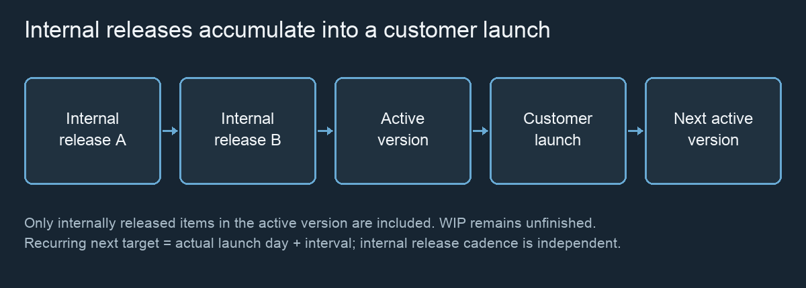

# Releases & Customer Launches {#releases}

FLOW distinguishes three milestones: successful testing completes the development workflow; internal release moves eligible work out of the delivery pipeline; customer launch delivers the active product version’s internally released items. These milestones can occur on different days.

*Explanatory version flow; no dates or counts are implied.*

## Work completion and internal release {#releases.internal-release}

Successful testing enters **Ready for Release**. This work is complete for dependency eligibility, but it remains unreleased WIP for delivery metrics.

**Flow-based** release checks every day. **Scheduled** release checks absolute days N, 2N, 3N and so on. Capacity is an integer number of items per opportunity. The default is Unlimited (internally represented by the maximum integer). Zero capacity prevents release. Oldest ready work is selected first.

Release consumes no developer or tester capacity. Testing completed at the end of an opportunity day can be included at that same boundary. Released-throughput and delivery-cost ratios use internal releases, not customer launches.

## Product versions {#releases.versions}

There is one active product version at a time. Internal releases attach to the version active on their release day. Customer launch closes that version and creates a successor automatically. Work still in progress is not launched and can release into the successor later.

**Rename** changes the active version name; names must be unique and nonblank. Default naming starts at Version 1.0. Launch history records the version, launch day and included items. This is sequential versioning, not parallel branches or parallel product versions.

## Customer launch decisions {#releases.customer-launch}

Open Product Version **Details** to see the active version and its delivery state. **Launch Now** includes all internally released items assigned to that active version. It does not advance time, include unrelated WIP or create a new staffing expense.

In interactive LIVE, a scheduled target stops advancement at the decision boundary. Choose Launch Now or **Plan / Postpone Launch** before continuing. Unattended Run automatically resolves scheduled launch targets. Manual mode has no automatic target; it does not silently launch at the end of a run.

The customer-launch celebration reflects a recorded launch. Dismissing it does not undo delivery, change costs or schedule another launch.

## Manual launch {#releases.manual}

Manual mode has no next launch day. Launch Now requires at least one internally released item when there is no pending scheduled decision. This prevents an ordinary empty manual launch.

Choose Manual in the strategy controls and **Apply launch strategy** to remove the current scheduled target. Work continues to accumulate as awaiting customer launch until you decide to launch.

## One-time launch and postponement {#releases.scheduled}

A one-time target is current day + amount × unit length. Working days have length 1; Sprints use the configured **Days / sprint** (default 10). These are simulated working periods, not real calendar dates.

**Plan / Postpone Launch** schedules a new future day relative to today. For example, on Day 40, postponing by 2 sprints of 10 days targets Day 60. It is not an addition to the old planned date. A pending scheduled launch can be resolved even with zero items.

After a one-time launch, the successor is Manual unless a new strategy is applied. Changing the launch plan is a delivery decision; it is distinct from a team configuration intervention taking effect next day.

## Recurring customer launches {#releases.recurring}

Recurring mode creates the next version’s target from the **actual launch day**, using the retained interval, unit and sprint length. Postponement changes the current target, not the recurring interval.

Example: a 20-day recurrence launched on Day 60 schedules Day 80. If the Day 80 target is postponed and actually launched on Day 90, the next target is Day 110. LIVE stops for each scheduled decision; unattended Run launches automatically. This rhythm is independent of the internal release schedule.

## Awaiting launch and launch history {#releases.awaiting}

Awaiting customer launch counts internally released items not already included in a customer launch. It excludes Ready for Release and all other WIP. Across several versions, launched item IDs are excluded rather than counted again.

The release vehicle’s label shows awaiting items. Click it for the corresponding estimated allocated cost, version, plan and launch count. **Customer delivery**, **Launch Economics** and **Launch history** in Product Version details explain the permanent records behind the animation.
