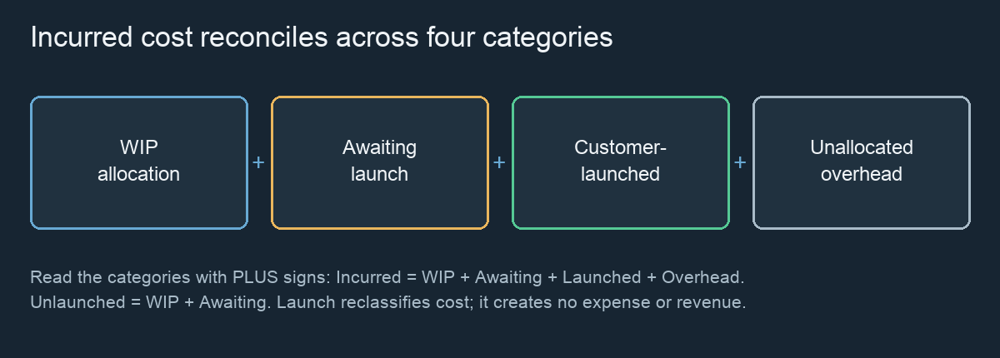

# Economics {#economics}

FLOW’s monetary figures use Swedish kronor (**SEK**) and illustrative staffing assumptions. They describe modeled resource expense and estimated allocation. They are not accounting valuations, revenue, margin, return on investment or measures of customer value.

*Accounting identity for modeled allocation, not revenue or profit.*

## Resource costs and daily team cost {#economics.resource-costs}

| Role / setting | Default |
| --- | --- |
| Developer monthly cost | 85,000 SEK |
| Tester monthly cost | 75,000 SEK |
| Specialist monthly cost | 100,000 SEK |
| Working days per month | 20 |

Specialists replace the corresponding number of ordinary developers in the cost calculation. The daily cost is:

`((developers − specialists) × developer monthly cost + specialists × specialist monthly cost) × developer availability / working days per month + testers × tester monthly cost × tester availability / working days per month`

At full availability, five developers, two testers and no specialists cost **28,750 SEK per simulated day**. This example uses the default rates, not the Day 42 screenshot’s settings.

Available idle staff still incur cost. Nominal processing capacity and productivity do not directly multiply staffing cost. Each day records the rates used then; changing rates does not rewrite prior daily costs.

## Period totals and delivery ratios {#economics.period-costs}

Total incurred cost accumulates recorded daily staffing costs. **Total team cost** in KPI Explorer sums the selected period, not necessarily the whole session.

**Cost / delivered item** divides period staffing cost by the number internally released during that period. **Delivered work / 1,000 SEK** divides original Development effort of those releases by period staffing cost and multiplies by 1,000 for display. Neither ratio includes customer value. Neither is the sum of item-level allocations for the release cohort.

If no releases occur, cost per delivered item is N/A. Delivered work per 1,000 SEK can be zero when cost is positive. Missing historical monetary observations are not filled using today’s rates.

## Launch Economics and cost allocation {#economics.cost-allocation}

Each day’s developer/specialist and tester staffing pools are allocated in proportion to recorded raw capacity consumed by each work item. Developer allocation includes Development, Code Review and Rework. The denominator is at least available pool capacity (and never less than summed observed consumption). This conservative calculation avoids allocating more than the recorded pool cost.

Accumulated item allocations are classified by state:

| Category | Meaning |
| --- | --- |
| Work in Progress Cost | Allocated item cost not yet internally released. |
| Awaiting Customer Launch Cost | Allocated cost of internally released items not yet customer launched. |
| Customer-Launched Cost | Allocations attached to items in recorded customer launches. |
| Unallocated Overhead | Remaining incurred staffing cost, including unused capacity and work not attributable to item processing. |

**Total Incurred Cost = WIP Cost + Awaiting Launch Cost + Customer-Launched Cost + Unallocated Overhead**

**Unlaunched Development Cost = WIP Cost + Awaiting Launch Cost**

A customer launch moves the included allocation from Awaiting to Customer-Launched. It creates no new expense or revenue. WIP and overhead do not move with it. Rework cost is already included in these allocations and staffing cost; adding it again double counts.

These are deterministic estimates from recorded observations, not actual invoices or individual time sheets. Old imported histories can lack cost or capacity data. The UI marks partial history and excludes unknown allocations rather than inventing them.

## Interpret economic consequences {#economics.interpretation}

A bigger team can deliver faster while increasing cost per item. A smaller unlaunched balance can follow a customer launch without any reduction in incurred expenditure. A large WIP allocation may reflect long-lived work rather than current-day spending.

Compare cost, delivered work, queues, cycle time and launch timing together. FLOW has no revenue or discount-rate model, so it cannot calculate profit or an optimal financial launch date. Station-level overhead should not be inferred from the global balance.
