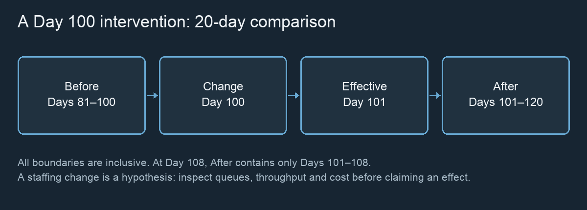
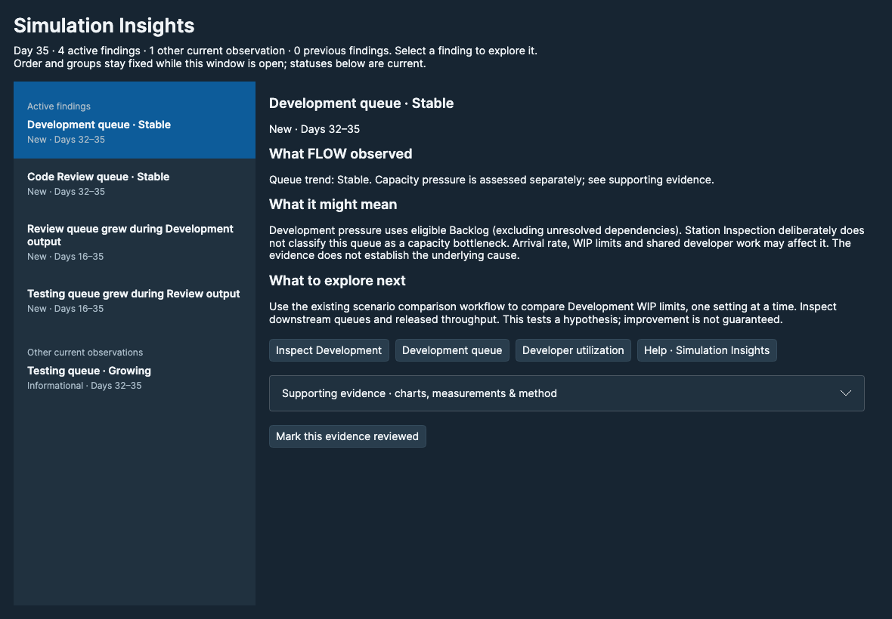

# Experiments & Decisions {#experiments}

An experiment tests a stated hypothesis under known assumptions. Establish a baseline, preserve its state, change one variable where practical, and compare both delivery and resource consequences. Treat surprising results as questions to investigate rather than verdicts.

*Timing diagram. Queue improvements must be observed; they are not guaranteed.*

## Interventions and before/after timing {#experiments.interventions}

1. Pause and record the problem, relevant KPI window and queue evidence.
2. Create a Checkpoint.
3. Select Change team / work. Edit the supported assumption and optionally label the change.
4. Apply Changes. Correct any validation error before resuming.
5. Advance enough days for the new assumption to affect downstream work.

**A change recorded on Day N takes effect on Day N+1.** For a Day 100 intervention and a 20-day comparison window, Before is **Days 81–100 inclusive** and After is **Days 101–120 inclusive**. At Day 108, only Days 101–108 are available in After; the remaining days are not invented.

Early Before history may also be partial. Other interventions inside the comparison range can confound interpretation. Do not confuse this intervention-anchored comparison with a dashboard’s current rolling window or its displayed historical range.

## Test staffing, productivity and WIP {#experiments.capacity}

| Hypothesis | What to inspect |
| --- | --- |
| Add a tester to reduce testing waits | Waiting count, tester utilization, cycle time, release throughput and daily cost. |
| Add a developer | Review pressure, Development output, downstream testing queue and cost. Shared priorities can change where capacity goes. |
| Increase stage productivity | Effective work, raw utilization, queues and throughput. Productivity is not extra staff. |
| Change WIP limits | Admission, queue displacement, age of WIP and idle capacity. Limits do not create capacity. |
| Change launch frequency | Awaiting-launch balance and launch history. Customer launch alone does not increase internal-release throughput. |

Use the guided staffing comparison when available: it captures a baseline from the same checkpoint and supports a matched evaluation period. It does not prove that all later random events remain paired. For broader changes, retain the baseline, record the exact settings and use the existing scenario comparison tools.

## Reproducibility and checkpoints {#experiments.reproducibility}

A checkpoint captures the simulation state and random-stream state. Restoring it returns to that state, including the timeline needed for replay. Saved LIVE sessions support later continuation under the supported model versions.

Record the seed, initial settings, arrival mode, effort distributions, intervention day and changed values. Keep the evaluation duration fixed when comparing alternatives. A seeded run is reproducible under the same event sequence; policies can diverge after an intervention. Repeat across multiple seeds for robustness.

## Avoid misleading conclusions {#experiments.causality}

A queue shrinking immediately after a staffing change may reflect work already completed upstream. A large release batch can temporarily improve throughput or cost per delivered item without improving the underlying flow. Different work sizes can change item-based KPIs. A customer launch can reduce unlaunched cost without reducing expense.

Use at least one flow measure, one queue/unfinished-work measure and one resource measure. State alternative explanations and note partial periods. Test one change where possible, then replicate across seeds. FLOW explores consequences within a simplified model; it cannot establish real-world causality by itself.

## Simulation Insights {#experiments.simulation-insights}

Simulation Insights is an optional, read-only interpretation of existing simulation observations. Open **Insights** in the compact LIVE toolbar. LIVE keeps running; no suggestion is applied and no popup or sound interrupts you. Click again to focus the same window. Close it and reopen it whenever needed.

*Current FLOW UI, Day 35. Actual Avalonia/Skia rendering from the product-polish verification harness; not a native macOS window capture.*

The master list shows queue observations for Development, Code Review and Testing, plus supported capacity relationships. Select a row to review its details. The window separates **What FLOW observed** (recorded facts), **What it might mean** (a hypothesis with limitations), and **What to explore next** (an optional way to investigate). Evidence strength describes the available observations, **not** the probability that an explanation is true.

**Insufficient evidence** means fewer than four comparable queue observations. A daily increase remains available in supporting evidence, but does not by itself establish a stable queue trend or sustained pressure. **Observed condition** describes directly observed states such as zero configured capacity or a stable queue. **Observable trend** describes changes in counts. **Trend with supporting capacity evidence** uses the existing Station Inspection rule: four nondecreasing daily queue counts with net growth, plus full relevant pool usage on the last three days. Code Review also requires positive review work on those days. This identifies potential pressure, not a proven root cause. A large queue alone is not enough.

**Queue trend is separate from queue pressure.** Growing, Shrinking, Stable and Insufficient data describe direction over up to **10 simulated days**, with at least **4 observations**. The fitted change from linear regression must exceed both 2 items and twice the residual RMS to enter a direction. Retention uses both 1 item and one residual RMS. A new direction needs an entry window followed by a window supporting the same direction above the lower retention threshold. Contrary or insufficient evidence clears pending confirmation. These stabilization thresholds are not confidence intervals. Stable means no confirmed direction above these thresholds, not necessarily an unchanging count. After configuration changes, trend history restarts; a change on Day N first contributes observations on Day N+1. Detailed evidence retains daily counts, actual days and thresholds. A growing queue is not proof of a capacity constraint.

Development uses eligible Backlog, excluding unresolved dependency waiting. The Development queue KPI includes all Backlog; these quantities are deliberately labelled differently. The existing station rule does **not** diagnose a Development bottleneck from saturation. Zero configured capacity is a separate current-configuration observation; a newly recorded configuration becomes effective next day.

Queue **pressure** classifications use at most **four** post-change observations. Capacity relationships use at most **20 simulated workdays**, restarting after any intervention. The window shows the actual periods, including partial periods; it does not pretend that queue and capacity evidence have the same dates. Capacity findings need at least four observations. For a change on Day 100, the first post-change evidence is Day 101. KPI Explorer retains its own selected rolling window and may include earlier history.

Capacity evidence uses recorded raw capacity and work-item transitions. Code Review shares developer capacity with Development, Rework and debt repayment; it is not a separate staffing pool. Positive upstream output alongside net downstream queue growth is a correlation. Endpoint growth need not be continuous growth. Stage transition totals can include repeat review/testing attempts and are not new KPI definitions. Internal releases are not customer launches.

Unused Testing capacity alongside no active or waiting work at day end does not establish that work was absent all day. The evidence also reports dependency-waiting and WIP-limit observations. These are possible context, not proof of a cause. No recommendation automatically reduces staffing.

**New, reviewed and updated:** the LIVE indicator counts only new relevant observations; a separate **updated** count identifies a changed classification or a returning condition. Selecting a row reviews the evidence currently displayed. Advancing the day or changing a queue count within the same classification does not make it new again. If a selected insight changes materially while LIVE runs, use **Mark this evidence reviewed** or select it again. Resolved observations remain marked **No longer relevant** with their observation dates. Stable queues and insufficient-history entries are informational and do not inflate the indicator.

**Stable viewing order:** when Insights opens, active findings are prioritized, followed by other current observations and previous findings. While the window remains open, existing rows keep their relative order and original group even when status, trend or priority changes. Status and evidence continue to update. New observations append within their initial group; selection follows the observation's stable identity. An observation no longer available in the current session is explicitly marked unavailable. Closing and reopening rebuilds priority order and selects the highest-priority active finding, falling back to current informational and then historical observations. A group's heading describes placement at opening/arrival; the row's status describes its current relevance.

Acknowledgements belong to the current open timeline only. Loading a session, starting/resetting a session or restoring a checkpoint clears them. They are not saved; reopening a saved session may therefore show relevant insights as new. Closing only the analysis window preserves acknowledgements. No save format, simulation state or random stream is changed.

Use the station buttons to inspect the existing workshop and the metric buttons to open the existing KPI Explorer. Contextual Help returns here. The list moves above the detail reader in narrow windows. Expand **Recorded metrics** for raw capacity and stage-output counts with their actual period. Suggestions direct you to the existing [guided staffing comparison](#experiments.capacity) or scenario comparison workflow. Test one supported setting at a time and inspect downstream flow, utilization and cost. Improvement is not guaranteed. This version does not infer intervention effects, perform automatic optimization or assign numeric causal confidence.

## Visual evidence and prepared comparisons {#experiments.insight-evidence}

The compact Insights list separates a short subject from its **New**, **Updated**, **Reviewed**, **Informational** or **No longer relevant** status and observation days. Select a row with the pointer or keyboard as before. The acknowledgement rules have not changed.

Evidence charts show recorded samples only. Choose **Queue size** or **capacity** in the chart selector. Blue dots represent the first named series; purple squares represent available capacity in a capacity chart. Axes show actual simulated days and either items or raw capacity units. A queue chart shows the number waiting at day end, **not** daily growth. Developer capacity is shared across Development, Review, Rework and debt repayment; it is not a reviewer staffing pool.

Charts use the selected insight's evidence period. A queue-pressure evidence chart normally has at most four observations; a capacity relationship normally has at most 20. The chart displays its actual first/last observed day and observation count. Missing observations are not filled with zero, connected by interpolated lines, or invented. Expand **Exact chart measurements** for every plotted sample; unavailable values are shown as N/A. The existing KPI Explorer retains its own selected period and definitions.

An increase between two endpoints does not establish growth on every intermediate day. Sustained pressure still requires the existing station rule. Two related series do not establish causation. Use the explanation and alternative hypotheses alongside the picture.

**Prepare comparison** is initially available only for relevant Testing queue-pressure or Review→Testing imbalance insights that suggest additional testers. Review, Development WIP, productivity and unused-capacity suggestions remain explanatory text; no unsupported action is shown. These can still be investigated through ordinary scenario workflows.

Preparing opens a review window. It captures the current LIVE state without creating a LIVE checkpoint, advancing time, consuming its random stream or applying an intervention. The original insight's observation dates and the captured baseline day are both shown: LIVE may have advanced since the observation, and can continue independently after preparation.

The baseline includes existing work items, history, configuration, seed and current random-stream state. The proposed configuration initially adds **one tester**. You may edit the total tester count to any valid whole number greater than the captured baseline, and choose 10, 20 or 40 evaluation days. Inspect all baseline/proposed assumptions in the disclosure. Only Tester count differs; developer count, availability, productivity, WIP, release policy, work supply, costs and other assumptions remain the same. A larger staffing count can still change total staffing expense through the unchanged cost model.

Nothing runs until you press **Confirm and run comparison**. Cancel/close before confirmation discards the proposal. No existing scenario is overwritten. After confirmation, the existing guided comparison engine restores two isolated branches from the same captured state and evaluates Days N+1 through N+window. Both branches use the existing automatic customer-launch decision policy used by guided baselines. This choice is displayed before confirmation; it may differ from manually answering launch decisions in interactive LIVE.

Results reuse the existing guided comparison view and calculations. “Intervention” in the result table means the isolated proposed branch, **not** an intervention applied to your current LIVE session. “Prepared alternative” labels its series. Return to LIVE focuses the original workspace. Closing during a run cancels the isolated calculation; closing the preparation window discards its in-memory result. Neither action changes LIVE or the baseline. To try another proposal after execution, close it and prepare again. Repeated preparation clicks focus the existing draft rather than overwriting edits.

The question is whether extra tester capacity changes waiting work and released throughput over a matched period. Improvement is not guaranteed. Shared starting seed/state does not guarantee paired later events: changed policies can consume randomness differently. Preparation is a temporary review workflow, not a new saved scenario format or an automatic optimization engine.
