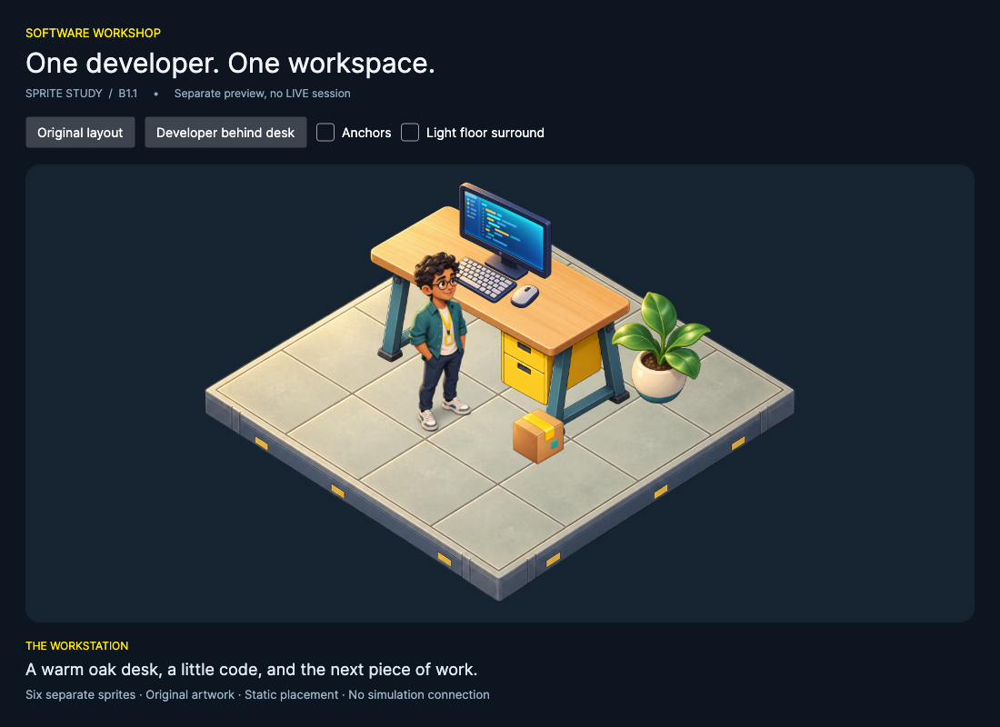

# Game View B1.1 — Sprite prototype

A separate Avalonia preview assembles six individually positioned transparent sprites into a small software workshop. It is not integrated into LIVE and does not replace any part of Game View B1. No animation or worker scheduling has been added.



## Run

From the repository root:

```sh
dotnet run --project tools/SpritePrototype -c Release
```

Use **Original layout** and **Developer behind desk** to inspect depth ordering. These buttons change a static world position immediately; they do not animate. **Anchors** shows the registration points. **Light floor surround** changes the background so transparency can be inspected.

The prototype is included under `tools` in the solution so normal solution builds compile it. The main application has no reference to the prototype. The prototype has no references to the simulation projects.

## Inspection and implementation choice

Existing B1 uses a custom Avalonia control, vector primitives, bounded worker/package representations and a cached snapshot projection. Its floor maps two world axes to diagonal screen axes, while most workstation positions are screen-space anchors. It scales a logical 1080×680 scene through a Viewbox. Repository source contained no reusable PNG/SVG game-art assets; existing PNGs under documentation were screenshots and charts.

The simplest sprite path is Avalonia `Bitmap`, embedded `AvaloniaResource`, `AssetLoader` and `DrawingContext.DrawImage`. The prototype uses the same Avalonia 11.3.22 packages already used by the application. There is no game engine. Avalonia.Headless is only a preview-verification option; native macOS was used for the delivered screenshots.

## Architecture

- `SpriteCatalog`: six embedded image definitions and an immutable demonstration layout. Every object, including the empty floor, is separate. The computer equipment can be positioned independently of the desk.
- `SpriteScene`: world coordinates, projection, pixel source rectangles, anchors, scale, ground depth and layer ordering.
- `SpriteAssets`: window-owned cache. Each image is decoded once, reused on repaint, and disposed when the window closes. Files are embedded into the assembly and loaded via `avares://`, with no runtime fetches.
- `SpriteWorldControl`: prepares draw order when the scene changes, then performs six image draws. It has no clock, simulation reference or advancing commands. High-quality bitmap interpolation and Viewbox scaling handle different viewport sizes.
- `PreviewWindow`: isolated preview controls, dark surroundings and responsive layout.
- `PrototypeVerification`: executable native verification of resource loading, caching, geometry, overlap, frame selection, screenshots and repaint behavior.

## Coordinates, sizes and anchors

All source PNGs are 1254×1254 RGBA with transparent backgrounds. Their original pixels remain unchanged. Curated source rectangles exclude empty padding without rewriting the files. Source/anchor values are in pixels; destination positions and sizes are in Avalonia DIPs.

`screenX = originX + (worldX − worldY) × tileWidth / 2`

`screenY = originY + (worldX + worldY) × tileHeight / 2 − elevation × tileHeight`

The prototype uses origin `(480,280)`, tile width 96, tile height 48, in a 960×570 logical viewport. +X goes down-right, +Y goes down-left, and elevation goes straight up. The flat floor is layer 0; objects are layer 1. Objects sort by `(layer, X+Y, stackOrder, stable ID)`. Elevation never changes ground depth. The computer shares the desk's ground anchor and uses elevation 2.83 and stack order 1, so it is drawn on the desktop.

| Asset | Source `(x,y,w,h)` | Anchor relative to source | Pixels → DIP | Frame size at scale 1 |
| --- | --- | --- | --- | --- |
| Floor | 20,260,1220,820 | 608,370 | 0.62 | 756×508 |
| Desk | 140,225,980,890 | 488,685 | 0.34 | 333×303 |
| Computer | 200,185,815,960 | 420,735 | 0.17 | 139×163 |
| Developer | 420,70,450,1130 | 215,1040 | 0.21 | 95×237 |
| Package | 290,295,680,740 | 338,595 | 0.10 | 68×74 |
| Plant | 280,195,735,820 | 345,765 | 0.18 | 132×148 |

The floor anchor registers its top surface center. Standing objects register around their ground-contact region, while the computer registers its support plane. Per-instance scale multiplies the asset's pixels-to-DIP factor around that anchor. The Viewbox uniformly scales the assembled world again to fit the window. The figure remains recognizable in the 800×640 preview, where its visible height is approximately 130 pixels.

The generated artwork approximates a common elevated isometric camera; its painted edges are not a mathematically exact tile set. Before expanding to a seamless full floor or multiple directions, artwork needs a locked camera/template and consistent registration. The demonstrated projection and overlap work; this is not a claim that the six illustrations form a production-ready tileset.

## Future frames, not animation

`SpritePose` defines Idle, Working, Walking and Collaborating. A definition can supply a `SpriteClip` containing multiple source rectangles/anchors for each pose. Frame selection is explicit; the renderer has no timer. Only Idle artwork is included. Requesting a missing pose fails clearly rather than pretending another state has been drawn. The verification checks optional multi-frame selection using in-memory frame metadata, without introducing animation or duplicate artwork files.

## Asset origins

Six new original assets were generated with the built-in image tool through the imagegen skill: floor, developer, desk, computer equipment, package and plant. The generation prompts used one rendering style, warm lighting, teal and yellow accents, and no copied external artwork. See [asset origins and usage-rights basis](../../../src/Simulation.Sprites/Assets/ORIGIN.md), [exact prompts](prompts.json), and [file/alpha inspection](assets-inspection.json).

## Verification results

- Full solution build: zero warnings and errors, including the standalone prototype.
- Existing tests: **611 passed**, zero failures/skips: 218 Core, 216 Application, 177 UI.
- Native macOS verification passed: all six embedded images loaded, cache identity and decode count, projection axes/elevation, anchor-preserving scale, deterministic foreground/background order, explicit optional frame selection, 1100×800 and 800×640 layouts, no sprite-source/destination clipping, and 1×/2× offscreen renders.
- Visual inspection covered dark/light backgrounds, the developer behind the desk, sharp scaled output and individual object placement. PNG analysis confirms true transparent and partially transparent pixels, not a painted checkerboard.
- Thirty native offscreen scene renders took 120 ms locally. This is a small smoke check, not a full-Game-View throughput benchmark. Repaints did not decode any additional assets.
- Source hashes before/after confirm that **every existing file under `src` is unchanged by B1.1**, including Game View B1, LIVE controls and all simulation layers. The preview cannot access a simulation session because it does not reference those assemblies.
- No runtime network dependency: all six resources are embedded. Image generation and rights-source lookup were development-time operations only.

Logs: [solution build](build.log), [existing tests](tests.log), [native verification](native.log), [source integrity](integrity.json), [render alpha inspection](render-inspection.json).

Additional screenshots: [800×640](screenshots/prototype-800.png), [developer behind desk](screenshots/overlap-behind.png), [light surround](screenshots/transparency-light.png), [transparent scene](screenshots/scene-1x.png), [double-resolution scene](screenshots/scene-2x.png).

Reproduce:

```sh
dotnet build SoftwareDevelopmentSimulation.sln -c Release -m:1 -nr:false
dotnet test SoftwareDevelopmentSimulation.sln -c Release --no-build -m:1 -nr:false
dotnet tools/SpritePrototype/bin/Release/net10.0/SpritePrototype.dll --verify
```

`--verify --headless` is available when a native display is unavailable. It uses real Skia rendering, but it was not used for the final delivered screenshots.

## Assessment and next step

The approach is suitable for a reviewed upgrade of the full Game View: the prototype demonstrates a clear visual improvement in facial detail, materials, silhouettes and lighting using Avalonia's built-in renderer. Separate assets compose correctly without a static scene backdrop, and no extra runtime graphics framework is necessary.

Before any expansion, review this actual rendered scene for style and scale. After approval, the next practical step is a small consistent production asset specification: fixed camera, character proportions, contact anchors, compatible desk orientations and separately authored action/direction frames. Keep the existing read-only snapshot mapping and aggregate-capacity semantics. A larger asset set should use cropped production textures or an atlas: these six original 1254-square files occupy about 36 MiB decoded, despite only about 4 MiB of PNG files. Ground-depth sorting handles this simple scene; larger intersecting furniture may need split foreground/background layers.

No additional workstations, character states, main-view replacement or animation were implemented. B1.1 stops here for visual review.
