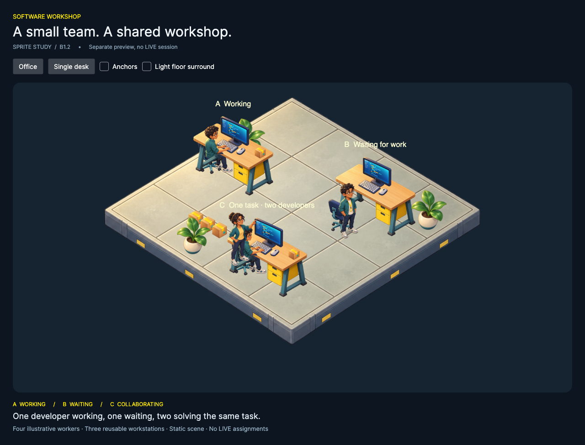

# Game View B1.2 — Multi-worker sprite prototype

The standalone preview now presents three workstations and four developers on one shared floor:

- **A — Working:** a seated developer with hands on the keyboard.
- **B — Waiting:** a standing developer near an empty chair and computer.
- **C — Collaboration:** a seated developer and a standing colleague pointing toward the same monitor, with one shared task package on the desk.

All states and packages are illustrative preview data, not real simulation assignments or work-item counts. No walking, animation, worker scheduling or LIVE replacement is included.



## Launch

```sh
dotnet run --project tools/SpritePrototype -c Release
```

The preview defaults to **Office**. **Single desk** retains the earlier B1.1 composition. **Anchors** displays registration points and **Light floor surround** allows transparency inspection. The main simulator still uses its existing Game View.

## Inspection of B1.1

The original developer, desk, computer equipment, plant, package and floor were already independent transparent PNG resources. They were embedded, cached and placed through world coordinates and source-frame anchors. B1.1 had one standing pose; stretching or rotating it would not create a convincing seated worker. Three new independent assets were therefore generated: a seated developer, a pointing colleague and an empty chair. Original image files are unchanged.

B1.1's basic ground-depth ordering works for separated objects but cannot alone depict a person interacting with a desk: the desk would hide the seated person's upper body. B1.2 introduces an explicit local overlap anchor and a reusable upper-body layer to solve that specific intersection.

## Scene and rendering architecture

`OfficeScene` describes stations, worker visual states and props. Each station composes instances of the same desk, computer and chair definitions. It does not draw a baked workstation illustration. Four `WorkerVisual` records select a `CharacterPose` through reusable `CharacterAppearance` mappings. The same seated artwork serves A's working pose and C's collaborating driver; the standing colleague is independently positioned next to that driver.

`SpriteObject` retains independent world position, elevation and instance scale. An optional `SortAnchor` sets local overlap relative to furniture without moving the object's actual position. Sorting is deterministic by layer, ground depth, local stack order and stable ID. The shared floor always draws first.

A seated worker composes two draws from **one decoded PNG**:

1. Full body at its ground depth, behind the desk.
2. Upper-body source rectangle, at the desk's overlap depth after the computer, so the head, torso and typing hands remain visible above the work surface.

Both parts share one worker position and scale. They move together when that worker's presentation position is changed. The lower body and chair remain behind the desk. This is static occlusion composition, not a second worker or a generated transition. The colleague uses the same explicit overlap mechanism to keep the pointing gesture visible near the monitor.

The asset cache now keys by resource URI, rather than visual-definition ID. Multiple workers, props and body layers share one bitmap per PNG. Each distinct definition's source rectangles are validated once. Office captions are cached. Render performs 24 object draws plus three labels; it does not decode files, sort objects or advance a clock on repaint.

The prototype assembly still has no reference to any simulation assembly. All resources are embedded `avares://` files; no network access is required at runtime.

## Geometry and composition

Office mode uses a 1280×880 logical viewport, origin `(640,360)`, tile width 96 and tile height 48. B1.1's single-desk mode retains 960×570 and origin `(480,280)`.

```text
screenX = originX + (worldX − worldY) × 48
screenY = originY + (worldX + worldY) × 24 − elevation × 48
```

Furniture and workers use a common office instance scale of 0.70 on top of their calibrated asset scales. One enlarged empty floor supports all stations. Props and plants occupy the perimeter and incoming-package area, leaving the center open as a walkway. The entire composition scales uniformly through a Viewbox rather than clipping when the window shrinks.

New frame metadata:

| Asset/definition | Source rectangle x,y,w,h | Anchor relative to source | Pixels to DIP |
| --- | --- | --- | --- |
| Chair | 245,135,775,1050 | 385,905 | .135 |
| Seated developer | 260,20,765,1270 | 540,1180 | .155 |
| Seated upper layer, same PNG | 260,20,765,780 | 540,1180 | .155 |
| Collaborating colleague | 225,115,725,1340 | 275,1235 | .167 |

An anchor can lie outside a cropped upper-body rectangle; that is intentional and preserves the full character's ground registration. [B1.1 documentation](../game-view-b1-1/README.md) records the original six assets' dimensions and conventions.

## Asset inventory and provenance

Nine source PNGs are embedded, all AI-generated original artwork created for this project with the built-in image tool through the imagegen skill. No external stock pack, emoji or runtime download is used.

| Source asset | Office instances/use |
| --- | --- |
| floor.png | One continuous floor |
| desk.png | Three desks |
| computer.png | Three independently positioned computer equipment sprites |
| chair.png | Three empty-chair sprites, two occupied through composition |
| developer.png | One standing, waiting worker |
| developer-seated.png | Two seated workers; upper layers reuse the same image |
| developer-collaborating.png | One independently positioned pointing colleague |
| package.png | Five work packages: two on desks, three incoming |
| plant.png | Three plants |

See [asset origins and usage rights](../../../src/Simulation.Sprites/Assets/ORIGIN.md), [new generation prompts](prompts.json) and [dimensions, alpha and file hashes](assets-inspection.json). The inventory counts logical workers separately from their rendering layers.

## Verification

- Full solution build passed with **zero warnings/errors**.
- All **611 existing tests passed**: 218 Core, 216 Application, 177 UI; zero failures/skips.
- Native macOS verification passed for nine embedded textures and multiple instances, shared body-layer caching, deterministic draw order, chair/body/desk overlap ordering, worker-layer registration after repositioning, instance scaling, pose selection, 1280×980 / 960×800 / 800×640 layouts, 1×/2× output and single-desk/office switching.
- Native screenshots were visually reviewed for all four characters, hands at keyboards, the pointing gesture, chair/desk overlap, background transparency and shrinking the scene.
- Thirty 1280×880 offscreen office renders took **372 ms** locally; no additional texture decodes occurred. This is a bounded preview smoke check, not a full-game or hardware-wide performance guarantee.
- Source hashes prove all 115 existing `src` files remain unchanged by B1.2. The simulation, LIVE controls and main Game View were not modified.

Evidence: [build](build.log), [tests](tests.log), [native checks](native.log), [source integrity](integrity.json).

Screenshots: [1280 window](screenshots/office-1280.png), [960 window](screenshots/office-960.png), [800 window](screenshots/office-800.png), [light surround](screenshots/light-surround.png), [full-resolution transparent scene](screenshots/scene-1x.png), [double-resolution scene](screenshots/scene-2x.png), [original single desk](screenshots/single-desk.png).

Reproduce:

```sh
dotnet build SoftwareDevelopmentSimulation.sln -c Release -m:1 -nr:false
dotnet test SoftwareDevelopmentSimulation.sln -c Release --no-build -m:1 -nr:false
dotnet tools/SpritePrototype/bin/Release/net10.0/SpritePrototype.dll --verify
```

## Limitations before animation

The prototype demonstrates reusable objects and convincing static interaction at these selected poses and desk orientation. It is not yet a general-purpose collision/occlusion system. The seated upper-body crop is calibrated for this pose; later directions or action frames will need matching masks and registration rather than rotating or deforming this image. The two seated developers intentionally share one appearance. Only selected static working, idle and collaboration poses exist; walking is explicitly unsupported.

At 800×640 the whole office remains visible, but figures and in-world captions become small. Use the larger view or the full-resolution scene for close visual review. The original floor artwork is an approximate isometric illustration, not a seamless production tile set. Before many assets or frames are added, crop/pack production textures to reduce decoded memory and lock the camera, proportions and lighting template.

Stop here for visual review. No additional stations, movement, animation or integration into LIVE has been implemented.
