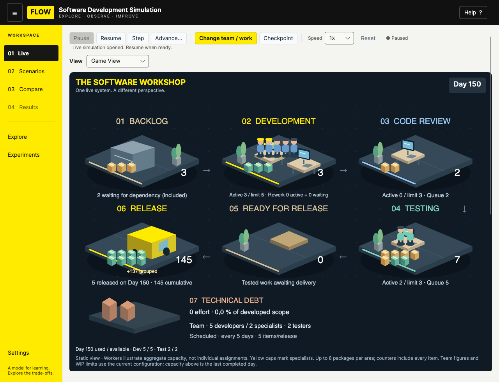
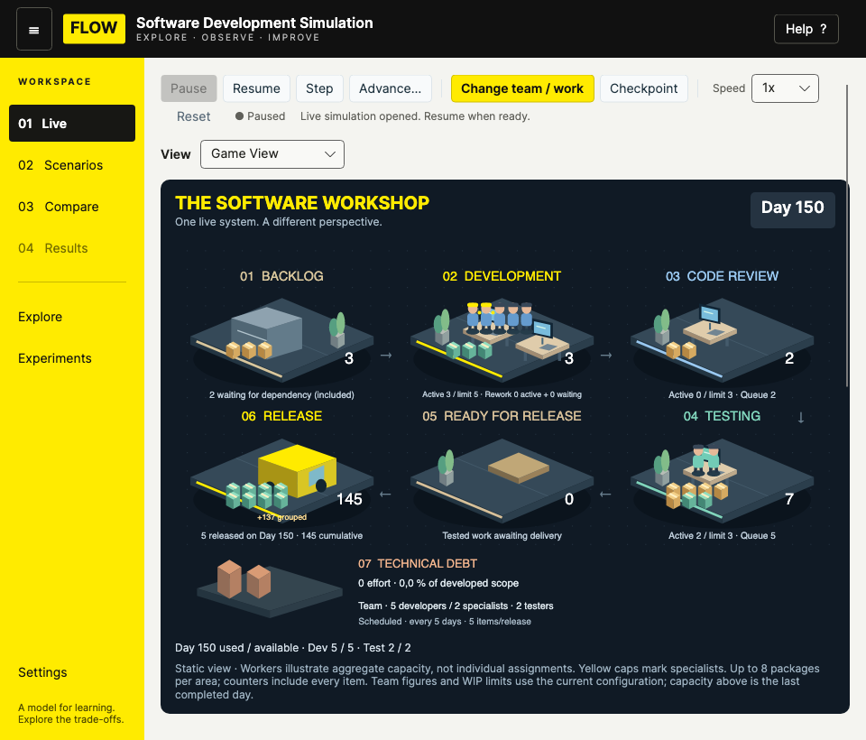
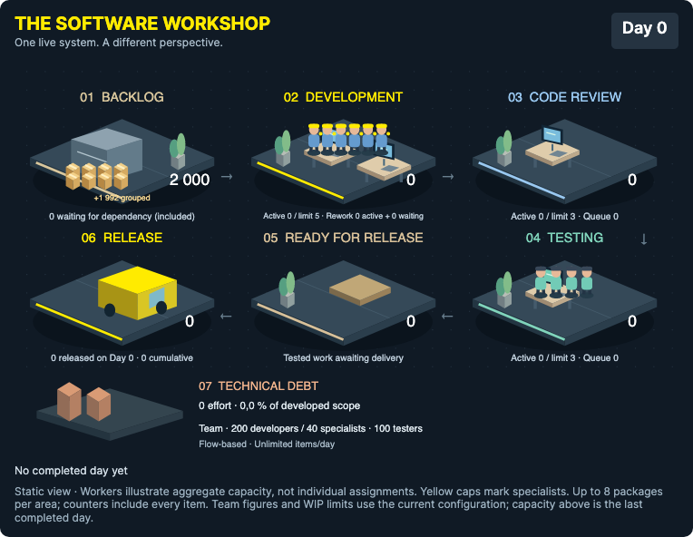

# Game View v1 — Stage A

Stage A is implemented. Animation (Stage B) and area inspection (Stage C) are deliberately not implemented before review.

## Use

Start or open a LIVE session, then select **Game View** in the **View** selector. Select **Flow Board** to return to the existing visualization. Both views use the same session and toolbar: Resume, Pause, Step, Advance, speed, Change, checkpoints, Save/Open and Reset. Game View reduces the surrounding overview to leave space for the complete world; Flow Board retains its existing overview, configuration and debt presentation. The existing intervention editor remains shared and available in either view.

The seven areas are Backlog, Development, Code Review, Testing, Ready for Release, Release and Technical Debt. Counts refer to the latest authoritative end-of-day snapshot. Dependency waiting is included in Backlog, not counted again. Rework is explicitly included in the Development area and its caption distinguishes active/waiting Rework. Technical Debt is an effort ledger, not a fictional queue of items. Release shows cumulative delivery and the actual number released on the displayed day; the truck is a static decorative prop, not an animation event.

The vector scene fits the viewport. It draws at most eight packages per area, six developer figures and four tester figures; counters and the team caption retain the full values. Yellow caps distinguish specialists. Figures illustrate aggregate capacity, not exact individual assignments. Current configuration headcounts/limits are distinguished from the latest completed day's used/available capacity, including immediately after an intervention.

## Architecture and reused state

- `LiveViewModel.Visualization` is a local presentation selection. Its setter only notifies presentation bindings; it never calls Start, Step, Pause, Resume, Restore or configuration mutation. The existing `LiveView` and `LiveViewModel` remain alive while switching.
- `GameSceneState.From` is a read-only, bounded projection of `LiveSimulation.CurrentSnapshot`, current configuration, debt ledger and the previous day's delivered count. The projection is cached until the existing Live refresh/load/restore/reset path invalidates it. No history copying or independent simulation execution is introduced.
- `GameView` supplies a dark local frame and responsive Viewbox. `GameWorldControl` renders reusable vector platforms, desks/monitors, characters, packages, plants and a parked delivery vehicle. It owns no timer, session reference, simulation command or worker scheduler. Drawing work is bounded independently of queue and team size; formatted labels are cached until the scene changes. Standard text around the world and an automation summary expose the semantics to assistive technology.
- Existing playback is unchanged: the sole `LiveViewModel.DispatcherTimer`, `StartCommand`, `ResumeCommand`, `PauseCommand`, `StepCommand`, `RunToDayCommand` and `Speed` continue to drive the same `LiveSimulation`. Interventions, checkpoint commands, persistence and the existing performance projections are reused.
- No Core, Application or Infrastructure source, allocation rules, schedules, calculations or global styling changed. Existing tests were left unchanged; focused tests were added in `GameViewTests.cs`.

## Verification

- Full solution: **604 tests passed** — 218 Core, 216 Application, 170 UI (7 added cases); zero failures/skips.
- UI and native verification builds: zero warnings/errors.
- Focused tests verify complete session/checkpoint equality on view switching, preservation of pending intervention drafts, pause semantics, one step per tick at 0.5x/10x, snapshot stage counts including Rework/dependencies, real scheduled release deltas, day zero/reset/checkpoint restore and bounded rendering counts with 2,000 items and a 200/100 team.
- Actual native Avalonia rendering verifies the selector's two-way binding, effective visibility, preservation of state/drafts, complete scene bounds at 1280×1000 and 960×820, return to Flow Board, fast advance from Day 150 to 250, and large-queue grouping. The measured fast-advance duration is recorded in `native.log`; this is a local smoke check, not a general performance benchmark.
- Screenshots use the actual `MainWindow`, application styles, Game View and Avalonia `RenderTargetBitmap`; no static scene image or mockup is used by the application.







Logs: `tests.log`, `build.log`, `native.log`. The previous capacity experiment remains separate and unchanged.

## Reproduce

From the repository root, with .NET 10 and a native desktop session:

```sh
dotnet test SoftwareDevelopmentSimulation.sln -c Release -m:1 -nr:false
dotnet build docs/verification/game-view-v1/GamePreview.csproj -c Release -m:1 -nr:false
dotnet docs/verification/game-view-v1/bin/Release/net10.0/GamePreview.dll
```

The preview briefly opens a window, performs the checks, writes screenshots and exits. Start the normal application with `dotnet run --project src/Simulation.UI -c Release`.

## Proposed Stage B, after Stage A review

1. Consume existing item IDs, `WorkItem.Transitions`, actual `ReleasedDay`/events and adjacent completed snapshots. Build a small visual transition buffer without changing or advancing the session. Initial load, reset and checkpoint restore replace the scene immediately rather than replaying fictitious transitions.
2. Animate a bounded subset of packages between their observed stages. At high speed or during batched advance, coalesce to the latest snapshot and summarize extra movement; never delay the engine or replay every missed frame.
3. Add illustrative worker activity driven by observed capacity totals for Development, Review, Testing, collaboration and debt repayment. Keep specialist markers and explicitly avoid named worker assignments or a separate scheduling model.
4. Trigger a short delivery departure only from real newly observed release events. No events on ordinary repaints, view switches, repeated snapshots or merely because a scheduled opportunity occurs with nothing released.
5. Use one presentation animation clock, active only while needed; respect pause/reduced motion and cap particle/character counts. Add tests for zero invented releases, stale-event clearing, fast-playback coalescing and unchanged complete simulation hashes.

Area hover/click inspection, selection and detailed item highlighting remain a separate Stage C proposal. Stage B has not begun.
