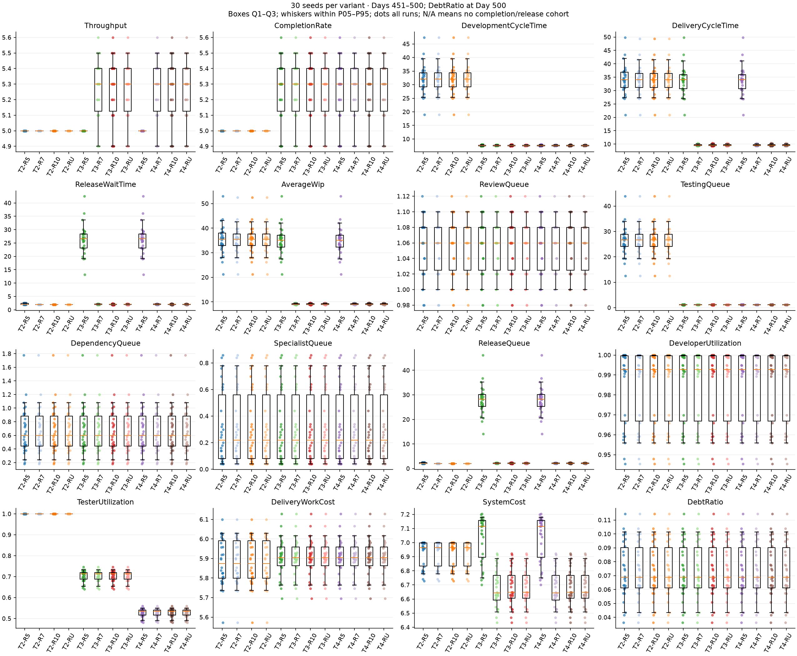
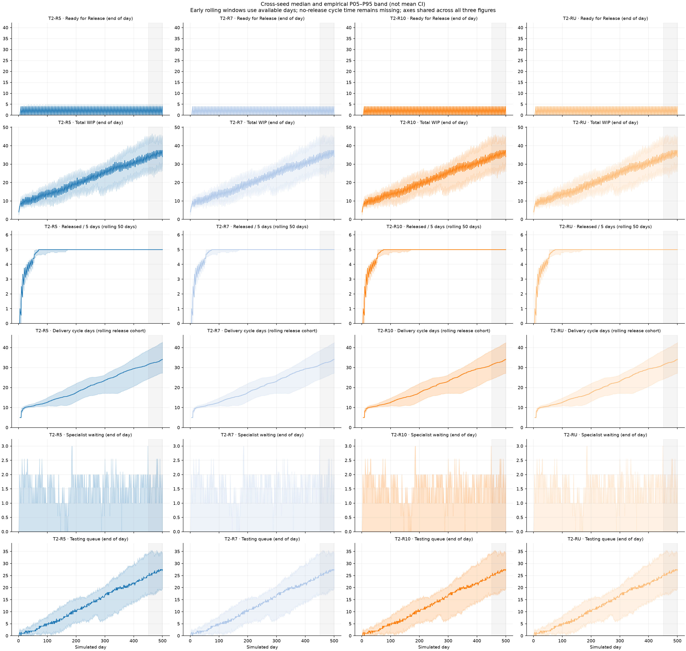
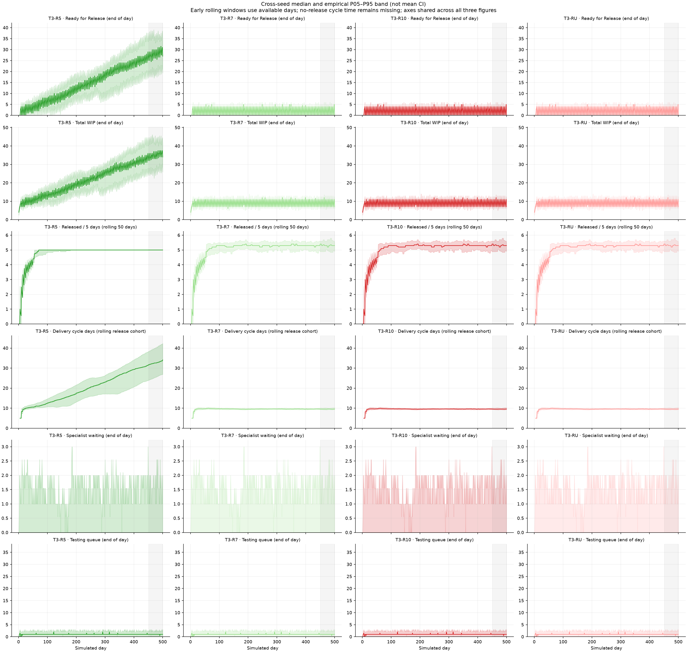
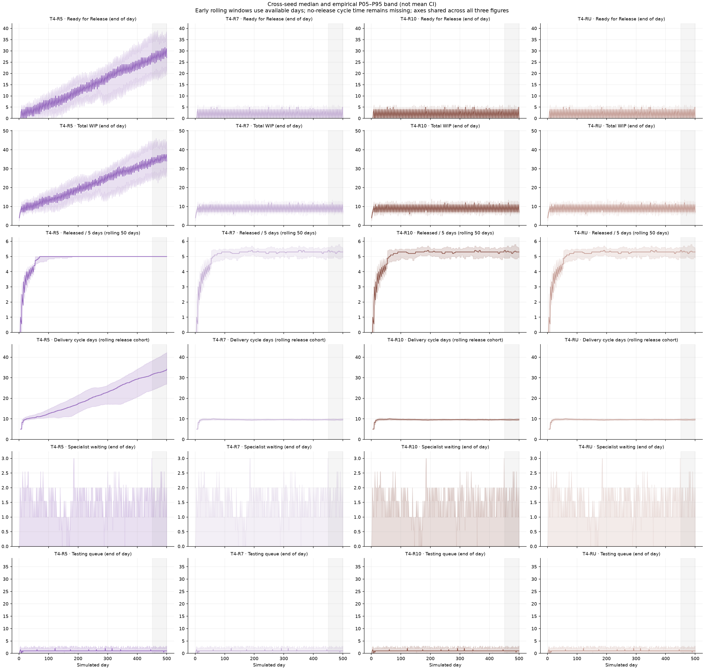

# Testing & Release Capacity Experiment v1

Model 0.8 · 30 seeds · 12 configurations · 500 simulated days · primary window Days 451–500.

## Findings

**Three testers and scheduled release capacity of at least 7 every five days remove the observed sustained downstream accumulation in this experiment.** A fourth tester provides no additional flow benefit with Testing WIP fixed at 3. Raising release capacity alone with two testers leaves Testing constrained; raising Testing alone with release capacity 5 moves the accumulating queue to Ready for Release.

Among the tested configurations, **T3-R7 is the smallest-capacity configuration that combines high delivered throughput with non-accumulating downstream queues over the observed horizon**. T3-R10 removes a small amount of residual batch waiting; Unlimited adds no observed benefit over 10. This is a conditional capacity choice, not proof of mathematical long-run stability or a universal staffing ratio.

The apparent final-window throughput and System Cost advantage of capacity 7 over 10 is a measurement-boundary effect, not evidence that smaller release capacity improves delivery. Both have the same cumulative releases by Day 500. See the paired comparisons and boundary analysis below.

## Design and complete matrix

The baseline is the existing validated S2 definition (`Validation.Complex` with two specialists). Its serialized request is checked for exact structural equality with the archived Specialist Capacity Experiment S2 request before any run. Only tester count and release capacity vary between configurations; seeds and the common 500-day horizon are experimental controls. No live interventions are applied.

| Configuration | Testers | Release capacity / opportunity | Release cadence |
| --- | --- | --- | --- |
| T2-R5 | 2 | 5 | Every 5 days |
| T2-R7 | 2 | 7 | Every 5 days |
| T2-R10 | 2 | 10 | Every 5 days |
| T2-RU | 2 | Unlimited | Every 5 days |
| T3-R5 | 3 | 5 | Every 5 days |
| T3-R7 | 3 | 7 | Every 5 days |
| T3-R10 | 3 | 10 | Every 5 days |
| T3-RU | 3 | Unlimited | Every 5 days |
| T4-R5 | 4 | 5 | Every 5 days |
| T4-R7 | 4 | 7 | Every 5 days |
| T4-R10 | 4 | 10 | Every 5 days |
| T4-RU | 4 | Unlimited | Every 5 days |

`Unlimited` is explicitly supported by Scheduled release, using the existing `int.MaxValue` sentinel. It removes the batch-size limit, **not the five-day cadence**. Opportunities remain Days 5, 10, 15, …, 500. The harness validates this before running.

Fixed settings: five developers including two specialists; availability and per-person capacity 1; productivity Development/Review/Testing 1.5/1/1; specialist demand 30%; residual dependencies 25%, mean wait 4 days; WIP 5/3/3; fixed base effort 5/1/2; Always Available supply; quality/rework disabled. Debt settings remain shortcut rate .3, shortcut effort reduction .5, creation factor 2, tolerance .1, repayment .2 and impact factor 1. Full requests are in [configurations.json](configurations.json).

Seeds 12345–12374 are paired across configurations. Seeds 12345, 12359 and 12374 repeat all 12 configurations, giving 36 additional determinism runs excluded from statistics. The source baseline is commit `79a5fcf`; no production simulation, UI, styling or application behavior was changed.

## Measurement and statistics

Rates are items per five simulated days. Time is simulated days. Queue/WIP means use daily end states in Days 451–500; final queues are separately reported. Debt Ratio is the Day-500 fraction. Utilization is consumed divided by available capacity. Cumulative releases span all 500 days.

The existing **Development Cycle Time** metric measures Development start to work completion, including Review and Testing; it is not Development-stage service time alone. Delivery Cycle Time and Release Wait use the released cohort, while Development Cycle Time and Delivery Work Cost use the work-completed cohort. Their means need not add up across differing cohorts. System Cost includes all window-consumed capacity, unfinished work and debt repayment, divided by window releases. It does not charge for idle staffing or release operations and is not money.

Every metric has mean, median, sample SD (n−1), min/max, type-7 P05/P95 and a Student-t 95% mean interval. Paired statistics subtract same-seed outcomes first; direction ties use 1e−9. These follow Multi-Seed Validation v1. All 30 isolated-factor pairs are provided, not only favorable comparisons. Intervals are exploratory, unadjusted Monte Carlo summaries under a pseudorandom-seed independence working assumption, **not real-world forecasting uncertainty**.

[Complete scenario statistics](scenario-summary.md) · [All paired statistics](paired-comparison.md) · [Compact tables](report-tables.md) · [Reproduction and definitions](README.md).

## Final-window performance

Means across 30 seeds:

| Configuration | Throughput | CompletionRate | DeliveryCycleTime | ReleaseWaitTime | SystemCost | ReleasedCumulative |
| --- | --- | --- | --- | --- | --- | --- |
| T2-R5 | 5 | 5 | 34.1760 | 2.1333 | 6.9247 | 492.9667 |
| T2-R7 | 5 | 5 | 34.0513 | 2 | 6.9247 | 493.1333 |
| T2-R10 | 5 | 5 | 34.0513 | 2 | 6.9247 | 493.1333 |
| T2-RU | 5 | 5 | 34.0513 | 2 | 6.9247 | 493.1333 |
| T3-R5 | 5 | 5.2667 | 33.8573 | 26.3193 | 7.0333 | 493.3000 |
| T3-R7 | 5.2700 | 5.2667 | 9.6548 | 2.0495 | 6.6772 | 520.4000 |
| T3-R10 | 5.2667 | 5.2667 | 9.6470 | 2.0414 | 6.6812 | 520.4000 |
| T3-RU | 5.2667 | 5.2667 | 9.6470 | 2.0414 | 6.6812 | 520.4000 |
| T4-R5 | 5 | 5.2667 | 33.8573 | 26.3193 | 7.0333 | 493.3000 |
| T4-R7 | 5.2700 | 5.2667 | 9.6548 | 2.0495 | 6.6772 | 520.4000 |
| T4-R10 | 5.2667 | 5.2667 | 9.6470 | 2.0414 | 6.6812 | 520.4000 |
| T4-RU | 5.2667 | 5.2667 | 9.6470 | 2.0414 | 6.6812 | 520.4000 |

| Configuration | AverageWip | TestingQueue | ReleaseQueue | DeveloperUtilization | TesterUtilization | DebtRatio |
| --- | --- | --- | --- | --- | --- | --- |
| T2-R5 | 35.2007 | 26.2733 | 2.1333 | 0.9849 | 1 | 0.0736 |
| T2-R7 | 35.0673 | 26.2733 | 2 | 0.9849 | 1 | 0.0736 |
| T2-R10 | 35.0673 | 26.2733 | 2 | 0.9849 | 1 | 0.0736 |
| T2-RU | 35.0673 | 26.2733 | 2 | 0.9849 | 1 | 0.0736 |
| T3-R5 | 34.8673 | 1.1227 | 27.8953 | 0.9849 | 0.7029 | 0.0736 |
| T3-R7 | 9.1300 | 1.1227 | 2.1580 | 0.9849 | 0.7029 | 0.0736 |
| T3-R10 | 9.1207 | 1.1227 | 2.1487 | 0.9849 | 0.7029 | 0.0736 |
| T3-RU | 9.1207 | 1.1227 | 2.1487 | 0.9849 | 0.7029 | 0.0736 |
| T4-R5 | 34.8673 | 1.1227 | 27.8953 | 0.9849 | 0.5272 | 0.0736 |
| T4-R7 | 9.1300 | 1.1227 | 2.1580 | 0.9849 | 0.5272 | 0.0736 |
| T4-R10 | 9.1207 | 1.1227 | 2.1487 | 0.9849 | 0.5272 | 0.0736 |
| T4-RU | 9.1207 | 1.1227 | 2.1487 | 0.9849 | 0.5272 | 0.0736 |

T2-R5 reaches exactly 5 releases per five days in every seed, but mean delivery cycle is 34.176 days and mean Testing queue is 26.273. A throughput ceiling is therefore not evidence of stable flow.

T3-R7 averages 5.270 releases per five days (95% mean CI 5.1965–5.3435; seed range 4.9–5.6), delivery cycle 9.6548 days (CI 9.5480–9.7616), and System Cost 6.6772 (CI 6.6262–6.7282). T3-R10 averages 5.2667, 9.6470 and 6.6812 respectively. Corresponding four-tester configurations have the same outcomes except lower tester utilization.

## Isolated factor effects

### Add testers, hold release capacity fixed

At **release capacity 5**, T3−T2 leaves throughput unchanged in all 30 seeds. Testing queue falls by 25.1507 items on average (paired 95% CI −27.3037 to −22.9976; decreases in all 30), while Ready for Release rises by 25.7620 (CI 23.6291–27.8949; increases in all 30). System Cost rises by .1087 (CI .0786–.1387; 26 increases, 4 decreases). Delivery cycle improves by only .3187 days, with 10 decreases and 20 ties. More completed work is chiefly accumulating before release.

At **release capacity 7**, T3−T2 increases throughput by .2700 (CI .1965–.3435; 26 increases, 4 decreases), reduces delivery cycle by 24.3966 days (CI −26.3989 to −22.3942; decreases in all 30), and reduces System Cost by .2475 (CI −.3160 to −.1790; 26 decreases, 4 increases). The four seeds with lower final-window throughput illustrate why capacity effects must also be checked over the full horizon and against queue inventory.

At **every fixed release capacity**, T4 and T3 have identical tested flow/cost/queue outcomes, with a lower tester utilization denominator for T4. The engine admits at most three active Testing items and assigns at most one raw unit per item per day. Testing demand cannot use a fourth unit of daily tester capacity with this WIP limit. This is a model constraint, not a general statement about real teams.

### Increase release capacity, hold tester count fixed

With **two testers**, R7−R5 has zero final-throughput change in all seeds and leaves Testing queues unchanged. Delivery cycle falls only .1247 days on average (CI −.2035 to −.0458; 8 decreases, 22 ties) through reduced batch waiting. R10 and Unlimited add no observed benefit over R7.

With **three testers**, R7−R5 increases throughput by .2700 (CI .1965–.3435; 26 increases, 4 decreases), reduces delivery cycle by 24.2026 days (CI −26.2086 to −22.1965; decreases in all 30), and reduces System Cost by .3562 (CI −.4527 to −.2596; 26 decreases, 4 increases). Testing queues are unchanged, while Ready for Release falls by 25.7373 items. The four-tester comparisons are the same.

R10−R7 changes final throughput by −.0033 (CI −.0102 to .0035; 1 decrease, 29 ties), delivery cycle by −.0077 days (CI −.0169 to .0014; 3 decreases, 27 ties), and System Cost by +.0040 (CI −.0042 to .0123; 1 increase, 29 ties). These small final-window mean intervals include zero. R10 and Unlimited match in the requested final metrics.

### Combined effect and window boundaries

T2-R5 → T3-R7 changes both factors; it is a combined result, not an isolated causal estimate for either factor. The fixed-factor contrasts show their interaction: relieving only Testing moves the accumulation downstream, while relieving only Release leaves Testing accumulation intact.

In **seed 12346**, T3-R10 has released 471 items by Day 450, versus 470 for T3-R7; both reach 525 by Day 500. Consequently the final window counts 54 releases for R10 but 55 for R7. R7's lower final-window System Cost uses that extra delayed release in the denominator. It is not lower consumed effort. Higher release capacity never falls behind in cumulative deliveries on any day in the checked adjacent-capacity comparisons; [boundary-effects.json](boundary-effects.json) retains all 270 paired histories' dominance and boundary diagnostics.

## Queue accumulation and transients

Full 500-day histories, including item snapshots, are retained losslessly. The analysis uses raw daily Testing queues, Ready for Release and total WIP, together with rolling delivery cycle and throughput. It compares **all ten consecutive 50-day blocks**, their within-block OLS slopes, and post-startup Days 51–500/201–500 drift. [All block means/slopes](block-comparison.md), [actual non-overlapping block rates](block-rates.md), and [longer-horizon slopes](long-horizon-slopes.json) distinguish queue growth from cadence oscillation. A rolling-endpoint block mean is not substituted for a true non-overlapping block rate.

Selected block means (raw queue/WIP counts; rolling cycle and throughput endpoints), after warm-up, mid-run and in the final block:

| Configuration | Metric | Days 51–100 | Days 251–300 | Days 451–500 |
| --- | --- | --- | --- | --- |
| T2-R5 | TestingQueue | 3.5167 | 14.3240 | 26.2733 |
| T2-R5 | ReadyForRelease | 2.0807 | 2.1333 | 2.1333 |
| T2-R5 | TotalWip | 12.3320 | 23.2333 | 35.2007 |
| T2-R5 | CycleTime | 11.7794 | 21.7101 | 32.7034 |
| T2-R5 | Throughput | 4.8505 | 5 | 5 |
| T3-R5 | TestingQueue | 1.1107 | 1.1327 | 1.1227 |
| T3-R5 | ReadyForRelease | 5.0893 | 15.9333 | 27.8953 |
| T3-R5 | TotalWip | 12.0580 | 22.9000 | 34.8673 |
| T3-R5 | CycleTime | 11.5256 | 21.3952 | 32.3922 |
| T3-R5 | Throughput | 4.8574 | 5 | 5 |
| T3-R7 | TestingQueue | 1.1107 | 1.1327 | 1.1227 |
| T3-R7 | ReadyForRelease | 2.1133 | 2.1293 | 2.1580 |
| T3-R7 | TotalWip | 9.0820 | 9.0960 | 9.1300 |
| T3-R7 | CycleTime | 9.7878 | 9.6113 | 9.6050 |
| T3-R7 | Throughput | 5.0735 | 5.2673 | 5.3045 |
| T3-R10 | TestingQueue | 1.1107 | 1.1327 | 1.1227 |
| T3-R10 | ReadyForRelease | 2.1067 | 2.1260 | 2.1487 |
| T3-R10 | TotalWip | 9.0753 | 9.0927 | 9.1207 |
| T3-R10 | CycleTime | 9.7856 | 9.6086 | 9.5927 |
| T3-R10 | Throughput | 5.0742 | 5.2676 | 5.3047 |

Post-startup daily OLS slopes, means across seeds (Days 51–500):

| Configuration | Testing queue slope | Release queue slope | Total WIP slope | Delivery cycle slope |
| --- | --- | --- | --- | --- |
| T2-R5 | 0.0573 | 0.0001 | 0.0575 | 0.0529 |
| T2-R7 | 0.0573 | 0.0000 | 0.0574 | 0.0529 |
| T2-R10 | 0.0573 | 0.0000 | 0.0574 | 0.0529 |
| T2-RU | 0.0573 | 0.0000 | 0.0574 | 0.0529 |
| T3-R5 | 0.0000 | 0.0574 | 0.0574 | 0.0528 |
| T3-R7 | 0.0000 | 0.0001 | 0.0002 | -0.0003 |
| T3-R10 | 0.0000 | 0.0001 | 0.0001 | -0.0003 |
| T3-RU | 0.0000 | 0.0001 | 0.0001 | -0.0003 |
| T4-R5 | 0.0000 | 0.0574 | 0.0574 | 0.0528 |
| T4-R7 | 0.0000 | 0.0001 | 0.0002 | -0.0003 |
| T4-R10 | 0.0000 | 0.0001 | 0.0001 | -0.0003 |
| T4-RU | 0.0000 | 0.0001 | 0.0001 | -0.0003 |

For T2-R5, the post-startup Testing-queue slope is .057260 items/day (95% mean CI .052075–.062445), positive in all 30 seeds. T3-R5 has a Ready-for-Release slope of .057387 (.052254–.062520), also positive in all 30. T3-R7 total WIP instead has slope .000158 (−.000059 to .000374; 17 positive and 13 negative), with block means near 9.1 rather than sustained multi-block growth.

All two-tester configurations accumulate in Testing. With three or four testers and capacity 5, Testing remains small but Ready for Release accumulates. Both families show rising total WIP and delivery cycle despite essentially flat late throughput. Three/four testers with capacity ≥7 instead show bounded-looking downstream fluctuations over this horizon. The five-day release cadence causes recurring sawtooth queues even with Unlimited; zero queue on a release day is not zero average release waiting.

Small nonzero within-block slopes can reflect cadence phase and stochastic fluctuations. The conclusion uses sustained multi-block changes and longer-horizon trends, not a test that one fitted slope differs from zero. No mathematical long-run stability is claimed from 500 days.

## Flow and capacity evidence

Final-window upstream means are identical across all configurations: **52.6667 Development completions and 52.7667 Review completions** over 50 days. Developer capacity consumption is 154.0199 Development + 52.7667 Review + 39.4467 repayment = 246.2333 of 250 available raw units, or **98.4933% utilization**. Collaboration consumes 8.6447 raw units already included in Development; it must not be added again. Review queue averages 1.056 items and does not exhibit downstream-style accumulation. Daily admissions precede work, so an end-of-day waiting item can represent the normal overnight handoff rather than sustained overload. Review uses the shared developer pool, but the observations do not identify a separate sustained Code Review bottleneck.

Two testers consume all 100 available units, complete 50 items, and receive 52.7667 Review completions: Testing inventory (waiting plus active) grows by **2.7667 items** on average in the final window. This reconciliation is checked per run, not merely on group means.

Three/four testers consume 105.4333 units and complete 52.6667 items: Testing inventory grows only .1 item on average over that window. With release capacity 5, only 50 are released and Ready for Release grows by **2.6667 items**. With capacity 7, the final release queue is zero in all seeds, and the final-window mean queue change is −.0333, reflecting the one carry-in item described above. [flow-balance.json](flow-balance.json) records exact per-seed inventory reconciliations.

T3 tester utilization is 70.2889%, versus 52.7167% for T4. They consume identical Testing work; unused capacity is not charged by System Cost. Capacity 5 uses all ten final-window release opportunities fully; capacity 7 is full on only .5667 of ten opportunities on average with three/four testers. This supports an upstream throughput constraint after the downstream restrictions are relieved.

| Configuration | Largest observed release batch | Largest Testing queue | Largest Ready queue | Largest total WIP | Peak tester units/day |
| --- | --- | --- | --- | --- | --- |
| T2-R5 | 5 | 45 | 5 | 56 | 2 |
| T2-R7 | 6 | 45 | 4 | 56 | 2 |
| T2-R10 | 6 | 45 | 4 | 56 | 2 |
| T2-RU | 6 | 45 | 4 | 56 | 2 |
| T3-R5 | 5 | 3 | 49 | 56 | 3 |
| T3-R7 | 7 | 3 | 6 | 15 | 3 |
| T3-R10 | 9 | 3 | 6 | 15 | 3 |
| T3-RU | 9 | 3 | 6 | 15 | 3 |
| T4-R5 | 5 | 3 | 49 | 56 | 3 |
| T4-R7 | 7 | 3 | 6 | 15 | 3 |
| T4-R10 | 9 | 3 | 6 | 15 | 3 |
| T4-RU | 9 | 3 | 6 | 15 | 3 |

**Constraint assessment by configuration:**

| Configuration | Dominant observed constraint |
| --- | --- |
| T2-R5 | Testing is fully used; Release has the matching 1 item/day ceiling. Increasing only one does not lift final throughput. |
| T2-R7 | Testing; release capacity has spare headroom. Testing queue and total WIP accumulate. |
| T2-R10 | Testing; release capacity has spare headroom. Testing queue and total WIP accumulate. |
| T2-RU | Testing; release capacity has spare headroom. Testing queue and total WIP accumulate. |
| T3-R5 | Release; completed work accumulates in Ready for Release while Testing has spare capacity. |
| T3-R7 | Development/shared developer pool is the next observed limiter; occasional batch waiting remains, without sustained downstream accumulation. |
| T3-R10 | Development/shared developer pool; no observed binding release batch limit and Testing has spare capacity. |
| T3-RU | Development/shared developer pool; no observed binding release batch limit and Testing has spare capacity. |
| T4-R5 | Release; completed work accumulates in Ready for Release while Testing has spare capacity. |
| T4-R7 | Development/shared developer pool is the next observed limiter; occasional batch waiting remains, without sustained downstream accumulation. |
| T4-R10 | Development/shared developer pool; no observed binding release batch limit and Testing has spare capacity. |
| T4-RU | Development/shared developer pool; no observed binding release batch limit and Testing has spare capacity. |

“Development/shared developer pool” includes Review's priority consumption, debt repayment, specialist routing, collaboration and shared Development WIP. It is an evidence-based diagnosis, not an independently estimated causal effect of changing Development or Review capacity; those factors were held fixed.

Debt Ratio averages **.07358** at Day 500 and is identical between configurations within each seed. Daily upstream work, Review, debt and selected upstream queue fields also match exactly across all configurations; three/four-tester daily flow fields match at fixed release capacity. [factor-checks.json](factor-checks.json) lists the exact compared fields. Higher delivered throughput here does not arise from extra debt creation. System Cost can nevertheless rise when more Testing work is completed but remains unreleased (T3-R5), and cohort timing can change Delivery Work Cost without changing an item's intrinsic work requirement.

## Validation evidence

- **360/360 primary runs passed**, covering **180,000 audited days** and **47,678,616 item observations**. No invariant failures were reported.
- **36/36 repeated runs matched exact complete session-state, result and metric hashes**.
- T2-R5 exactly reproduces the archived S2 production metric trajectories for the first 300 days in all 30 seeds; [baseline-equivalence.json](baseline-equivalence.json) records this independent horizon-extension check.
- The reused checker verifies conservation, raw capacity and effort accounting, active WIP constraints, specialist allocation, dependency timing, debt accounting, release timing/FIFO/capacity, item cost events and authoritative rolling/trend metrics.
- Additional checks verify constant developer/tester capacity, fixed specialist count/cadence, request factor isolation, exact queue-flow reconciliation and cumulative release dominance for higher batch capacities.
- **597 tests passed**: 218 Core, 216 Application and 163 UI; zero failed/skipped. Solution and harness builds completed with **zero warnings and zero errors**.
- Production SHA-256 comparison and Git diff confirm no production changes; see [production-integrity.json](production-integrity.json). Build/test/validation/analysis logs are retained in this directory.

Performance observations such as accumulating queues, spare tester capacity or window-dependent rankings are not invariant failures.

## Final assessment and limits

1. **Highest observed final-window mean Released throughput:** T3-R7 and T4-R7, **5.2700 per five days**. The tiny .0033 advantage over capacity 10/Unlimited is entirely the Day-450 carryover in one seed, not superior service capacity. All T3/T4 configurations with capacity ≥7 average **520.4 cumulative releases** by Day 500.
2. **Lowest observed mean Delivery Cycle Time:** T3-R10, T3-RU, T4-R10 and T4-RU, **9.6470 days**. Capacity 7 averages 9.6548; only three paired seeds differ, and the mean difference interval includes zero.
3. **Lowest observed mean System Cost:** T3-R7 and T4-R7, **6.6772 raw units/released item**. The small difference from capacity 10 is again a release-cohort denominator effect. This is not a payroll-cost comparison; an idle fourth tester carries no modeled charge.
4. **Best observed balance of throughput and non-accumulating queues:** **T3-R7** is the lowest tested staffing/batch-capacity combination in that group. **T3-R10** is a reasonable alternative for the slightly lower observed batch waiting. Four testers or Unlimited provide no further observed benefit under the fixed WIP and demand assumptions. No competing objectives have been merged into a score.

A flat 5-per-five-days curve in T2 or R5 does not establish sustainable flow: upstream excess is accumulating. Conversely, capacity ≥7 is not generally reached as an output ceiling; the shared developer-side flow becomes the observed limit. “Non-accumulating” describes these finite histories, not a proof of infinite-horizon equilibrium.

Important limitations: fixed base effort, constant availability, disabled defects/rework, fixed WIP and five-day release cadence, unlimited work supply, this specialist/dependency mix, and this debt policy. Queues outside active stages are not capped by active WIP limits. There is no release labor cost, idle-capacity cost, salary, training or recruitment cost. Development/Review capacity, cadence, WIP and demand were not varied, so no optimal value for them is inferred. The 30 seeds and 500 days characterize this model configuration, not real-world reliability or forecast uncertainty. Pointwise P05–P95 bands omit extreme tails; full min/max, per-seed records and history archives remain available. Overlapping rolling windows and daily points are correlated.

See [README.md](README.md) for reproduction commands and the artifact inventory. All deliverables are confined to this experiment directory.
